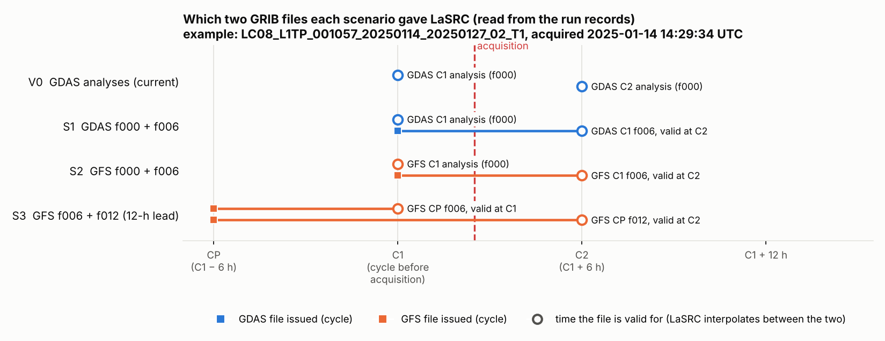
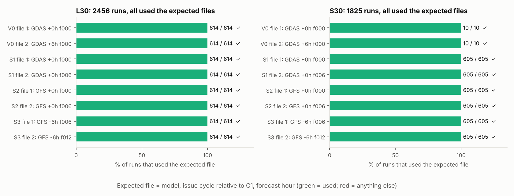

# Checking and changing the ancillary (GRIB) files used by each run

How the low-latency ancillary test makes sure that every LaSRC run used the water vapor and ozone
files of its own scenario, how to check that for one run or for all runs, and how to change the
input files. Companion to [FULL_L30_ANCILLARY_LATENCY_RESULTS.md](FULL_L30_ANCILLARY_LATENCY_RESULTS.md),
[PILOT_ANCILLARY_LATENCY_RESULTS.md](PILOT_ANCILLARY_LATENCY_RESULTS.md) and
[ANCILLARY_SOURCE_COMPARISON.md](ANCILLARY_SOURCE_COMPARISON.md).

All paths are on Meteor under the test root `R=/rtmp/tvo/LaSRC_ancillary_latency_20261120`.
Scripts are in `$R/scripts/`.

## 1. Summary

Each run leaves an evidence trail at every step, and one script checks all of it:

```text
 scenario rule          staged for LaSRC            read by LaSRC              result
 (select_pair.py)  -->  runs/<p>/<S>/aux/<g>/LADS -->  "AUX input file" ...  -->  "uwv, uoz, pres"
 which two files        two links, named by          + time weights              + record JSON
                        valid time, with md5         in the LaSRC log            (records/<p>/<S>/<g>.json)
```

- **Before the run:** `select_pair.py` decides the two files from the acquisition time and scenario.
  The pool files carry a manifest with their md5 and the time written inside the GRIB.
- **During the run:** the log lists each staged file, where it links to, its md5, and the reference
  and valid time inside it; LaSRC then prints which pair it opened, the time weights and the
  water vapor and ozone it used.
- **After the run:** `run_record.py` copies all of that into one JSON record per run, and
  `audit_ancillary_inputs.py` checks every record against the scenario rule and the manifest.

Result so far: **all 60 pilot runs pass all checks.** A test with deliberately corrupted records
(wrong file, wrong checksum, wrong weight, two scenarios with the same files) was caught by the
corresponding checks. Run the audit on the full set with the command in [section 6](#6-check-all-runs-at-once).

## 2. Which files each run should use

LaSRC needs water vapor and ozone at two times that bracket the acquisition. C1 is the 6-hourly
cycle at or before the acquisition, C2 = C1 + 6 h, CP = C1 − 6 h.

| Run | File for time C1 | File for time C2 | Where it comes from |
|---|---|---|---|
| V0 | GDAS C1 analysis (f000) | GDAS C2 analysis (f000) | GDAS mirror |
| S1 | GDAS C1 analysis (f000) | GDAS C1 6-h forecast (f006) | mirror + pool |
| S2 | GFS C1 analysis (f000) | GFS C1 6-h forecast (f006) | pool |
| S3 | GFS CP 6-h forecast (f006) | GFS CP 12-h forecast (f012) | pool |

**Example:** granule `S2A_MSIL1C_20250109T164651_…_T16TCK_…`, acquired 2025-01-09 16:46:51 UTC,
so C1 = 12Z, C2 = 18Z, CP = 06Z:

| Run | File named `gdas1.PGrbF00.250109.12z` (time C1) | File named `gdas1.PGrbF00.250109.18z` (time C2) |
|---|---|---|
| V0 | `/nas/rstor/tvo/GFS_2025/gdas.20250109/12/atmos/gdas.t12z.pgrb2.1p00.f000` | `/nas/rstor/tvo/GFS_2025/gdas.20250109/18/atmos/gdas.t18z.pgrb2.1p00.f000` |
| S1 | same as V0 | `$R/ancillary_pool/gdas/20250109/12/gdas.t12z.1p00.f006.valid2025010918.grb2` |
| S2 | `$R/ancillary_pool/gfs/20250109/12/gfs.t12z.1p00.f000.grb2` | `$R/ancillary_pool/gfs/20250109/12/gfs.t12z.1p00.f006.valid2025010918.grb2` |
| S3 | `$R/ancillary_pool/gfs/20250109/06/gfs.t06z.1p00.f006.valid2025010912.grb2` | `$R/ancillary_pool/gfs/20250109/06/gfs.t06z.1p00.f012.valid2025010918.grb2` |

To print this list for any acquisition time:

```bash
python3 $R/scripts/select_pair.py --acq 2025-01-09T16:46:51 --scenario S2 \
  --pool $R/ancillary_pool --gdas-mirror /nas/rstor/tvo/GFS_2025
# gdas1.PGrbF00.250109.12z /rtmp/.../ancillary_pool/gfs/20250109/12/gfs.t12z.1p00.f000.grb2
# gdas1.PGrbF00.250109.18z /rtmp/.../ancillary_pool/gfs/20250109/12/gfs.t12z.1p00.f006.valid2025010918.grb2
```

It prints `MISSING <path>` and exits with code 3 if a file does not exist.

## 3. Where the files live

- **GDAS mirror** (V0, and S1's first file): `/nas/rstor/tvo/GFS_2025/gdas.YYYYMMDD/HH/atmos/gdas.tHHz.pgrb2.1p00.f000`,
  full GDAS 1° analysis files (~40 MB) from the NOAA NODD archive.
- **Ancillary pool** (all forecast and GFS files): `$R/ancillary_pool/<model>/<YYYYMMDD>/<HH>/`, built
  by `build_ancillary_pool.sh` from NOAA NODD (`noaa-gfs-bdp-pds`). Only the two fields LaSRC needs
  (PWAT and TOZNE) are downloaded, using the byte ranges in each file's `.idx`. Each forecast is
  stored twice:
  - `<model>.tHHz.1p00.fFFF.grb2`: as published (reference time = cycle, forecast time = FFF h);
  - `<model>.tHHz.1p00.fFFF.validYYYYMMDDHH.grb2`: **relabelled** so the reference time equals
    the valid time and the forecast time is 0 (see [section 4](#4-how-a-file-reaches-lasrc)).
- **Manifest**: `$R/ancillary_pool/manifest.csv`, one row per pool file:

```text
path,bytes,md5,grib_reference,grib_forecast_h,grib_valid
gdas/20241231/00/gdas.t00z.1p00.f006.grb2,153478,d853a2e7…,2024-12-31T00,6,2024-12-31T06
gdas/20241231/00/gdas.t00z.1p00.f006.valid2024123106.grb2,153478,14acb578…,2024-12-31T06,0,2024-12-31T06
```

`grib_reference` and `grib_forecast_h` are read from inside the file, not from its name.

## 4. How a file reaches LaSRC

1. **Staging.** For each granule, `run_scenario.slurm` (function `stage_aux`) empties
   `$R/runs/<p>/<S>/aux/<granule>/`, links the static auxiliary files, and creates `LADS/` with two
   symbolic links from `select_pair.py`. The link names follow LaSRC's convention,
   `gdas1.PGrbF00.YYMMDD.HHz`, by **valid time**. The folder is rebuilt for every run, so changing
   links by hand has no lasting effect (see [section 7](#7-change-the-input-files)).
2. **Container.** The aux folder is mounted at `/mnt/lasrc_aux` (S30) or `/aux` (L30) with
   `LASRC_AUX_MODE=grib`. In S30 the original `prepare_grib_aux.sh` (which copied files from a
   nested mirror) is replaced by a stub that only lists the staged pair.
3. **Selection inside the container.** The wrapper (`do_lasrc_sentinel.py` / `do_lasrc_landsat.py`)
   picks the two `gdas1.PGrbF00.*` files whose names bracket the acquisition time and passes them to
   LaSRC as `AUX` and `AUX2`.
4. **Reading.** LaSRC (`open_gb_oz_wv_datasets` in `lut_subr.c`) reads PWAT and TOZNE from each file,
   **takes the time from the GRIB reference time and ignores the forecast time**, computes the two
   time weights from the acquisition time, and prints the scene-centre values. This is why forecast
   files must be relabelled: an unrelabelled f006 file would be read as if it were valid at its cycle
   time, 6 hours too early.

## 5. Check one run

Take `S2`, granule T16TCK, S30. Set:

```bash
R=/rtmp/tvo/LaSRC_ancillary_latency_20261120
G=S2A_MSIL1C_20250109T164651_N0511_R126_T16TCK_20250109T184430
P=s30; S=S2
```

**5.1 The record (everything in one place)**

```bash
python3 -m json.tool $R/records/$P/$S/$G.json
```

```json
{ "scenario": "S2", "acquisition": "2025-01-09T16:46:51", "exit_status": 0,
  "lads": [
   {"name": "gdas1.PGrbF00.250109.12z",
    "source": ".../ancillary_pool/gfs/20250109/12/gfs.t12z.1p00.f000.grb2",
    "bytes": 152665, "md5": "ad85ad7ce316a473c848a1682ce46a6c"},
   {"name": "gdas1.PGrbF00.250109.18z",
    "source": ".../ancillary_pool/gfs/20250109/12/gfs.t12z.1p00.f006.valid2025010918.grb2",
    "bytes": 152888, "md5": "05a347632abb68a5a1d888bf37b00e50"}],
  "lasrc_aux": "gdas1.PGrbF00.250109.12z", "lasrc_aux2": "gdas1.PGrbF00.250109.18z",
  "first_weight": 0.203193, "second_weight": 0.796807,
  "uwv": 0.28, "uoz": 0.3125, "pres": 987.582214 }
```

Compare `source` with the table in [section 2](#2-which-files-each-run-should-use): GFS 12Z f000 and
GFS 12Z f006 relabelled to 18Z, as S2 requires.

**5.2 The log (what the container saw)**

```bash
grep -E "<-|reference|AUX input|AUX2 input|Selected GRIB|weight|uwv, uoz" $R/logs/$P/$S/$G.log
```

```text
  gdas1.PGrbF00.250109.12z <- .../ancillary_pool/gfs/20250109/12/gfs.t12z.1p00.f000.grb2
  gdas1.PGrbF00.250109.18z <- .../ancillary_pool/gfs/20250109/12/gfs.t12z.1p00.f006.valid2025010918.grb2
    PWAT  reference 2025-01-09 12:00Z  forecast +0h  valid 2025-01-09 12:00Z  grid 360x181
    PWAT  reference 2025-01-09 18:00Z  forecast +0h  valid 2025-01-09 18:00Z  grid 360x181
... Selected GRIB auxiliary pair: gdas1.PGrbF00.250109.12z, gdas1.PGrbF00.250109.18z
  AUX input file: gdas1.PGrbF00.250109.12z
  AUX2 input file: gdas1.PGrbF00.250109.18z
in open_gb_oz_wv_datasets()   First weight 0.203193
in open_gb_oz_wv_datasets()   Second weight 0.796807
   uwv, uoz, pres: 0.280000, 0.312500, 987.582214
```

What to look for:

- the `<-` lines point to the expected source files;
- each staged file has `forecast +0h` and a reference time equal to the time in its name (12Z, 18Z);
- LaSRC opened the same two names (`AUX`, `AUX2`);
- the second weight equals (acquisition − C1) / 6 h: (16:46:51 − 12:00) / 6 h = 0.797.

**5.3 Inspect a GRIB file directly**

```bash
python3 $R/scripts/grib2_inspect.py \
  $R/ancillary_pool/gfs/20250109/12/gfs.t12z.1p00.f006.grb2 \
  $R/ancillary_pool/gfs/20250109/12/gfs.t12z.1p00.f006.valid2025010918.grb2
```

The published file shows `reference 2025-01-09 12:00Z forecast +6h valid 18:00Z`; the relabelled one
shows `reference 18:00Z forecast +0h valid 18:00Z`. Same data, different label.

**5.4 Checksums**

```bash
md5sum $R/ancillary_pool/gfs/20250109/12/gfs.t12z.1p00.f006.valid2025010918.grb2
grep "gfs/20250109/12/gfs.t12z.1p00.f006.valid2025010918.grb2" $R/ancillary_pool/manifest.csv
```

Both must give `05a347632abb68a5a1d888bf37b00e50`, the md5 in the record.

**5.5 The scenarios of one granule used different files**

```bash
for S in S1 S2 S3; do echo "$S: $(python3 -c "import json;r=json.load(open('$R/records/$P/$S/$G.json'));print(' '.join(x['md5'][:8] for x in r['lads']), r['uwv'], r['uoz'])")"; done
```

Each scenario must show a different pair of checksums. (They can still give the same `uwv`/`uoz`
after LaSRC's rounding; that is expected, see
[ANCILLARY_SOURCE_COMPARISON.md](ANCILLARY_SOURCE_COMPARISON.md).)

**5.6 Recompute the water vapor and ozone from the files**

```bash
python3 $R/scripts/scene_centre_values.py --root $R --granule T16TCK
```

Reproduces LaSRC's `uwv`/`uoz` from the two GRIB files with LaSRC's own steps. Agreement (exactly,
or within one storage step) confirms the values came from the files listed.

## 6. Check all runs at once

```bash
python3 $R/scripts/audit_ancillary_inputs.py --root $R --out $R/reports_full/audit_problems.csv
```

Options: `--products "s30"`, `--scenarios "S2"`, `--granule T16TCK`, and `--md5-mirror` to recompute
the checksums of the large GDAS mirror files as well (slow). The script exits with 0 when everything
passes.

| Check | What it verifies | Fails when |
|---|---|---|
| values | the run finished and LaSRC logged `uwv`, `uoz` | the container failed (e.g. a damaged input zip) |
| names | the two staged names match C1 and C2 for the acquisition | wrong cycle chosen |
| sources | each name links to the scenario's file | wrong model, cycle or forecast hour |
| read | LaSRC opened the same two names | the wrapper picked other files |
| checksum | pool files match the manifest | a file changed after the pool was built |
| grib time | the time inside each pool file equals its name, forecast +0 h | a forecast was not relabelled |
| weights | second weight = (acquisition − C1) / 6 h | wrong time interpolation |
| distinct | the scenarios of one granule used different files | two scenarios point to the same files |

Output on the pilot (60 runs):

```text
audited 60 runs: 0 problem(s)
  values    OK
  names     OK
  sources   OK
  read      OK
  checksum  OK
  grib time OK
  weights   OK
  distinct  OK
```

With records deliberately altered (a wrong md5, an S3 file swapped for f006, a wrong weight, and an
S1 record given S2's files), the audit reported each one under `checksum`, `sources`, `weights` and
`distinct`, with the granule and the expected file.

### 6.1 Plot which files each scenario used

`plot_scenario_inputs.py` is a second, independent check. It reads only the run records (not the
selection script's output) and works out, from each staged file's source path, which model, issue
cycle and forecast hour the run actually used, and the time the file is valid for. It then compares
these with the rule (table in section 2) and checks LaSRC's time weight.

```bash
python3 $R/scripts/plot_scenario_inputs.py collect --root $R --out $R/reports_full/scenario_inputs/inputs.csv
python3 $R/scripts/plot_scenario_inputs.py plot --csv $R/reports_full/scenario_inputs/inputs.csv \
  --out $R/reports_full/scenario_inputs --granule LC08_L1TP_001057      # login node (needs matplotlib)
```



*One granule, all four runs: squares mark when each file was issued, circles the time it is valid for.
LaSRC interpolates between the two valid times; the dashed line is the acquisition.*



*Every run, per file slot: share of runs that used the expected file (green) or any other file (red).*

Result for the large-scale test: L30 2,456 of 2,456 runs and S30 1,825 of 1,825 runs used the expected
files. The S30 count includes the two granules whose input zips are damaged: their runs failed, but
they were given the right ancillary files. S30 V0 has 10 records (the pilot granules); V0 is the
existing GDAS-analysis output and was not rerun.

The three scripts are also in [`tools/`](tools/) so they can be read and run outside Meteor.

## 7. Change the input files

**7.1 Change which files a scenario uses.** Edit the rule in `$R/scripts/select_pair.py`, function
`pair()`. For example, a new S4 using the GDAS 6-h and 12-h forecasts from the previous cycle:

```python
    elif scen == "S4":
        f1, f2 = pool(p, "gdas", cp, 6, c1), pool(p, "gdas", cp, 12, c2)
```

Add `"S4"` to the `choices` of `--scenario` in `select_pair.py` and in `scene_centre_values.py`.
Check the new rule before running anything:

```bash
python3 $R/scripts/select_pair.py --acq 2025-01-09T16:46:51 --scenario S4 --pool $R/ancillary_pool --gdas-mirror /nas/rstor/tvo/GFS_2025
```

**7.2 Add files to the pool.** The pool only holds what `build_ancillary_pool.sh` downloaded
(GDAS f006; GFS f000, f006, f012). For other models, cycles or forecast hours, extend the list of
downloads in that script, or fetch and relabel one file by hand:

```bash
# PWAT + TOZNE only, from NOAA NODD, then relabel to valid time
bash $R/scripts/fetch_pwat_tozne.sh gdas 20250109 06 12 /tmp/gdas.t06z.1p00.f012.grb2
python3 $R/scripts/grib2_relabel_stdlib.py /tmp/gdas.t06z.1p00.f012.grb2 \
  $R/ancillary_pool/gdas/20250109/06/gdas.t06z.1p00.f012.valid2025010918.grb2
python3 $R/scripts/grib2_inspect.py $R/ancillary_pool/gdas/20250109/06/gdas.t06z.1p00.f012.valid2025010918.grb2
```

Keep the naming convention (`<model>.tHHz.1p00.fFFF.validYYYYMMDDHH.grb2`) so `select_pair.py` finds
the file, and add the new files to `manifest.csv` (rerunning `build_ancillary_pool.sh` with the new
dates rewrites it), otherwise the audit reports them as `not in manifest`.

**7.3 Use modified fields (sensitivity tests).** `grib2_offset_stdlib.py` adds a constant to PWAT or
TOZNE without re-encoding the file, for example +10 kg/m² of water vapor:

```bash
python3 $R/scripts/grib2_offset_stdlib.py in.grb2 out.grb2 --var PWAT --delta 10
python3 $R/scripts/grib2_offset_stdlib.py in.grb2 out.grb2 --var TOZNE --delta 25
```

Store modified files under a separate model name (for example `ancillary_pool/gdas_pwatp10/…`) and
add a scenario for them as in 7.1, so they can never be mixed up with the real data.

**7.4 Run one granule with the new files.**

```bash
echo $G > $R/lists/s30/one.txt
sbatch --job-name=s4_test --time=06:00:00 --output=$R/logs/slurm/s4_test_%j.out \
  --export=ALL,ROOT=$R,PRODUCT=S30,SCENARIO=S4,LIST=$R/lists/s30/one.txt,ONE_PER_TASK=1,TRIM=no \
  $R/scripts/run_scenario.slurm
```

Then check it with [section 5](#5-check-one-run) and
`audit_ancillary_inputs.py --scenarios S4 --granule T16TCK` before using the results.

**7.5 Rerun a run that already finished.** The runner skips any granule whose record has
`"exit_status": 0`. To force a rerun, move the record away first:

```bash
mkdir -p $R/records_old && mv $R/records/$P/$S/$G.json $R/records_old/
```

## 8. Pitfalls

- **Forecast files not relabelled.** LaSRC uses the GRIB reference time and ignores the forecast
  hour. A published f006 file would be treated as valid 6 h too early. Always use the
  `.valid…` files; the audit's `grib time` check catches this.
- **Names decide what LaSRC opens.** The wrapper selects files by their `gdas1.PGrbF00.YYMMDD.HHz`
  name, not by content. A file linked under the wrong name is read at the wrong time; the `names` and
  `sources` checks catch this.
- **Same values do not mean same files.** LaSRC rounds water vapor to 0.005 g/cm² and ozone to 2.5 DU,
  so different files often give identical `uwv`/`uoz`. Check the checksums (`distinct`), not the
  values, to confirm the files differ.
- **Records make the runner skip granules.** A stale record with exit status 0 stops a granule being
  rerun with new files (7.5).
- **Damaged input granules.** Two S30 inputs (`T19GGM` 2025-01-05 and `T36QWJ` 2025-07-23) are
  incomplete zip files; those runs stop before LaSRC and appear under `values`.
