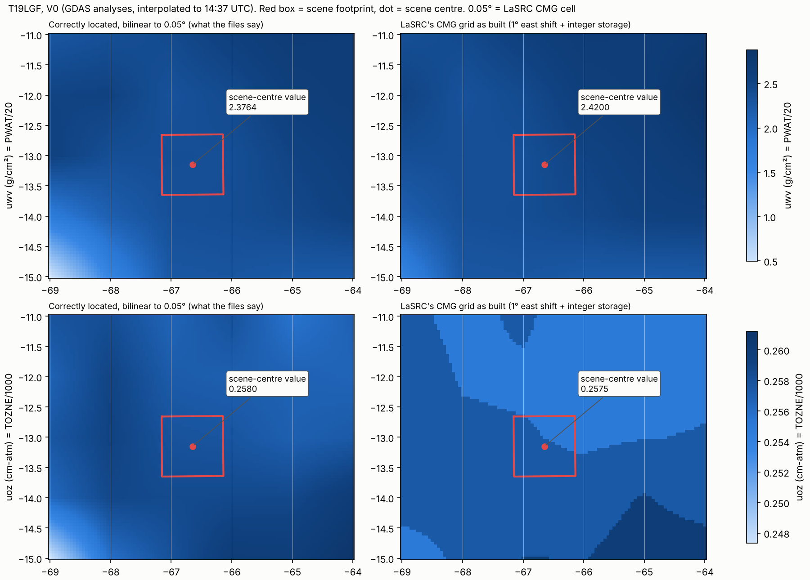
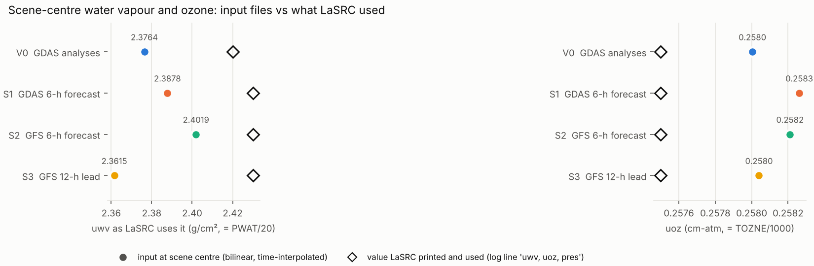
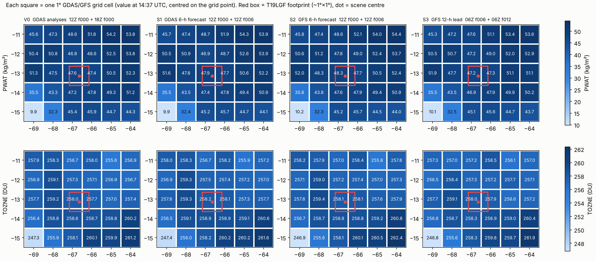
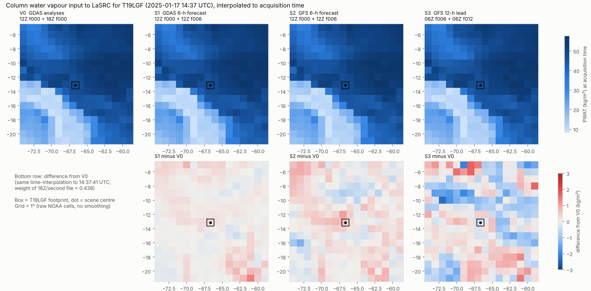
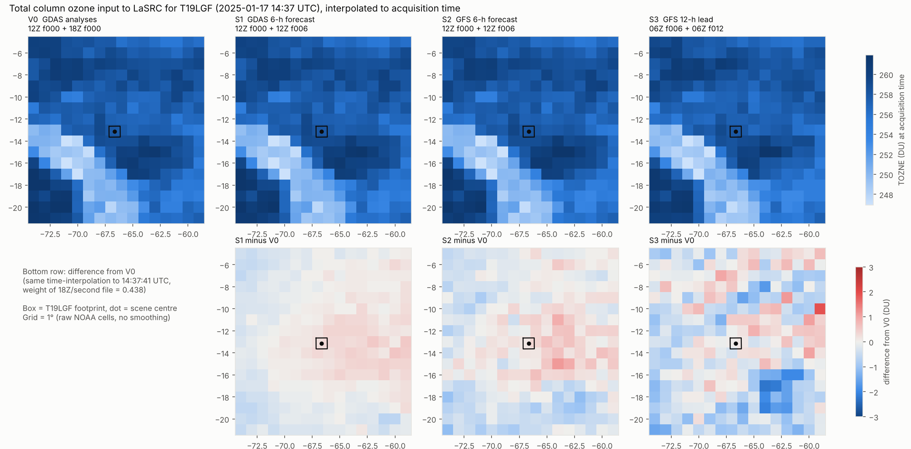

# Water vapor and ozone in LaSRC from different NOAA ancillary sources

How much do the water vapor and ozone values that LaSRC actually uses change when the GRIB
ancillary comes from the **GDAS analysis**, a **GDAS 6-h forecast**, or the **GFS** (6-h or
12-h lead)? This note documents a smoke test on three Sentinel-2 granules run with the code on
this branch (`b271310`, unmodified) and explains how LaSRC turns a GRIB file into the two numbers
it applies to a scene.

**Status:** smoke test, 3 granules (all January 2025). Results are solid for these scenes. They are
not yet a statistical sample (see [Limitations](#7-limitations-and-next-steps)).

## 1. Summary

- **The forecast and GFS options gave the same water vapor and ozone inside LaSRC as the GDAS
  analysis**, or differed by one or two storage steps. Surface reflectance was **pixel-identical**
  for 2 of 3 granules and within **0.02–0.4 DN** (mean |diff|) for the third.
- **Why:** LaSRC uses one water vapor and one ozone value per scene, taken from a single 0.05° CMG
  cell and stored as integers. The steps are **0.1 kg/m²** for water vapor and **2.5 DU** for
  ozone. The differences between the ancillary options at these scenes were mostly smaller than
  one step.
- **Latency:** the GFS 6-h forecast pair is available 0–3.6 h after acquisition and the GFS 12-h
  lead pair before acquisition, compared with 7–13 h for the GDAS analyses. On these scenes there
  was no measurable cost in the inputs LaSRC used.

## 2. Test setup

| | |
|---|---|
| Code | This branch, `b271310` (3.5.2.0), **no changes**. HLS Sentinel container as used for the GDAS-vs-VIIRS validation. |
| Run | Full S30 chain (Fmask, LaSRC, NBAR, bandpass, COGs). Only the two GRIB files differ between runs. |
| Ancillary data | NOAA NODD `s3://noaa-gfs-bdp-pds`, 1° `pgrb2.1p00`. GDAS analyses from the validation mirror; other files downloaded with only PWAT and TOZNE (`.idx` byte ranges). |
| Validation | Existing LaSRC validation CLI vs the VIIRS-based product, immediate and final stages, Ju et al. (2025) Table 7 thresholds. |

### Granules

| Granule | Acquisition (UTC) | Cycles C1 / C2 | Why chosen |
|---|---|---|---|
| `S2A_MSIL1C_20250117T143741_N0511_R096_T19LGF_20250117T175824` | 2025-01-17 14:37:41 | 12Z / 18Z | Tropical wet season (Bolivia), high water vapor |
| `S2C_MSIL1C_20250127T174641_N0511_R098_T15VVD_20250127T192639` | 2025-01-27 17:46:41 | 12Z / 18Z | Smoke-plume artifact granule; only failed band (B03) in the 522-granule GDAS-vs-VIIRS validation |
| `S2B_MSIL1C_20250131T063019_N0511_R077_T43VDD_20250131T082148` | 2025-01-31 06:30:19 | 06Z / 12Z | Largest final-stage GDAS-vs-VIIRS difference (B03, 1.26× threshold) |

### Scenarios

C1 is the 6-hourly cycle before the acquisition, C2 = C1 + 6 h and CP = C1 − 6 h.

| Run | File valid at C1 | File valid at C2 | Ancillary ready after acquisition |
|---|---|---|---|
| **V0** baseline | GDAS C1 f000 (analysis) | GDAS C2 f000 (analysis) | 7–13 h |
| **S1** | GDAS C1 f000 | GDAS C1 **f006** (forecast) | 1–7 h |
| **S2** | GFS C1 f000 | GFS C1 **f006** | 0–3.6 h |
| **S3** | GFS CP **f006** | GFS CP **f012** | 0 (before the overpass) |

Notes:

- LaSRC reads the GRIB **reference time** and ignores the forecast hour. Forecast files were therefore
  relabelled so that reference time = valid time and forecast hour = 0 (data sections unchanged).
- All runs are at 1°, so S1–S3 differ from V0 only in model run or forecast lead, not in resolution.

## 3. How LaSRC turns the GRIB files into scene water vapor and ozone

From `lasrc/c_version/src/lut_subr.c` (`open_gb_oz_wv_datasets`, `get_cart_linesamp`,
`get_cart_interp`) and `compute_refl_subr.c` (`init_sr_refl`):

1. **Read** PWAT (kg/m²) and TOZNE (DU) from both files on the 1° grid (181 × 360). The reader
   rotates each row to start at "−180°".
2. **Interpolate in time** at every grid point:
   `value = w1 × file1 + w2 × file2`, where `w2 = (t_acq − t1) / 6 h`.
3. **Resample to the CMG grid** (0.05°, 3600 × 7200) with **bilinear** interpolation. The
   nearest-neighbour branch (`whichone == 1`) is disabled. CMG cells are sampled at their corners
   (KNOWN_ISSUES #4, 0.025° offset).
4. **Store as integers**, truncating rather than rounding:
   `wv = uint16(PWAT × 10)` gives 0.1 kg/m² steps, and `oz = uint8(TOZNE × 0.4)` gives 2.5 DU steps.
5. **Pick the scene value.** The scene-centre pixel is converted to lat/lon and rounded to the nearest
   CMG cell. That one cell gives `uwv = wv / 200` (g/cm², the inherited factor of 2, KNOWN_ISSUES #1)
   and `uoz = oz / 400` (cm-atm). LaSRC prints them as `uwv, uoz, pres` and uses this single pair
   for the whole tile. Per-pixel values are only used in the optional original-aerosol path, which
   HLS does not use.

*T19LGF, V0. Left: water vapor and ozone bilinear-resampled to 0.05°. Right: LaSRC's CMG field
as built and stored as integers. The 2.5 DU ozone steps are visible as bands.*

### Independent reproduction

A standalone script (`reproduce_lasrc_uwv_uoz.py`, outside LaSRC) implements steps 1–5 and reads the
same GRIB files. It reproduces the `uwv, uoz` values LaSRC printed in **11 of 12 runs** across the
three granules. The one miss is T43VDD S1 ozone, where the value is 146.99 vs a step boundary at 147
(float precision).

## 4. Checks that each run used its own ancillary files

- **Different inputs.** Each run's log records the source, size and MD5 of the two staged files.
  They differ between V0, S1, S2 and S3 for every granule. All staged files decode with
  reference time = valid time, forecast +0 h, 360 × 181 grid.
- **LaSRC read them.** Every log shows `AUX input file` / `AUX2 input file` = the staged pair and
  the expected time weights (T19LGF 0.562 / 0.438, T15VVD 0.037 / 0.963, T43VDD 0.916 / 0.084).
- **Baseline reproduces the validation.** At T19LGF, all 13 LaSRC SR bands from V0 are byte-identical
  to the validated GDAS run. V0 vs VIIRS at T15VVD (B03 60.1 DN) and T43VDD (B03 69.3 DN) equal the
  values in the 522-granule validation.

## 5. Results

### 5.1 Water vapor and ozone: the input files vs what LaSRC used

"At scene" is the correctly located, time-interpolated value at the scene centre. "LaSRC used" is
the printed `uwv, uoz` (identical to the reproduction except where noted).

| Granule | Run | PWAT at scene (kg/m²) | Stored `wv` | LaSRC `uwv` | TOZNE at scene (DU) | Stored `oz` | LaSRC `uoz` |
|---|---|---|---|---|---|---|---|
| T19LGF | V0 | 47.54 | 484 | **2.42** | 257.97 | 103 | 0.2575 |
| | S1 | 47.77 | 486 | **2.43** | 258.22 | 103 | 0.2575 |
| | S2 | 48.06 | 486 | **2.43** | 258.18 | 103 | 0.2575 |
| | S3 | 47.23 | 486 | **2.43** | 258.01 | 103 | 0.2575 |
| T15VVD | V0 | 1.377 | 14 | 0.07 | 381.06 | 159 | 0.3975 |
| | S1 | 1.380 | 14 | 0.07 | 380.61 | 159 | 0.3975 |
| | S2 | 1.374 | 14 | 0.07 | 379.42 | 159 | 0.3975 |
| | S3 | 1.319 | 14 | 0.07 | 380.25 | 159 | 0.3975 |
| T43VDD | V0 | 2.918 | 28 | 0.14 | 359.39 | 147 | 0.3675 |
| | S1 | 2.919 | 28 | 0.14 | 359.41 | 146 (LaSRC: 147) | 0.3675 |
| | S2 | 2.919 | 28 | 0.14 | 359.41 | 147 | 0.3675 |
| | S3 | 2.935 | 28 | 0.14 | 360.01 | 147 | 0.3675 |

Spread across V0–S3 at the scene centre:

| Granule | PWAT spread | Relative | TOZNE spread | Relative | Storage step (PWAT / TOZNE) |
|---|---|---|---|---|---|
| T19LGF | 0.83 kg/m² | 1.7% | 0.25 DU | 0.1% | 0.1 kg/m² / 2.5 DU |
| T15VVD | 0.06 kg/m² | 4.3% | 1.64 DU | 0.4% | 0.1 kg/m² / 2.5 DU |
| T43VDD | 0.02 kg/m² | 0.6% | 0.62 DU | 0.2% | 0.1 kg/m² / 2.5 DU |

- **T15VVD and T43VDD** are January high-latitude scenes with very little water vapor (1.4 and
  2.9 kg/m²). The four options differ by less than one storage step, so LaSRC used the same `uwv`
  and `uoz` for all four.
- **T19LGF** is wet and the options differ by up to 0.8 kg/m². At the cell LaSRC reads, S1–S3
  happen to fall in the same 0.1 kg/m² step (48.6–48.7). V0's 18Z analysis is slightly drier (48.47)
  and lands two steps lower.

*Each square is one 1° GDAS/GFS cell at the acquisition time. The red box is the T19LGF footprint,
which overlaps four cells.*

### 5.2 Surface reflectance

**Between runs** (final HLS products, pixel comparison against V0):

| Granule | S1 vs V0 | S2 vs V0 | S3 vs V0 |
|---|---|---|---|
| T19LGF | mean \|diff\| 0.02–0.41 DN (B8A … B08), 2–41% of pixels changed | identical to S1 | identical to S1 |
| T15VVD | **0 pixels differ** (B03, B12) | 0 | 0 |
| T43VDD | **0 pixels differ** (B03, B12) | 0 | 0 |

At T19LGF the small differences follow the one-step water vapor change (2.42 → 2.43). The Fmask layer
differs in 0.03% of pixels, all in the aerosol bits that LaSRC writes.

**Against VIIRS** (existing validation, mean |diff| in DN, final stage):

| Granule | Band (Ju threshold) | V0 | S1 | S2 | S3 |
|---|---|---|---|---|---|
| T19LGF | B03 (55) | 0.3 | 0.3 | 0.3 | 0.3 |
| | B12 (64) | 0.5 | 0.4 | 0.4 | 0.4 |
| T15VVD | B03 (55) | 60.1 FAIL | 60.1 FAIL | 60.1 FAIL | 60.1 FAIL |
| | B04 (52) | 35.8 | 35.8 | 35.8 | 35.8 |
| | B12 (64) | 6.4 | 6.4 | 6.4 | 6.4 |
| T43VDD | B03 (55) | 69.3 | 69.3 | 69.3 | 69.3 |
| | B04 (52) | 42.1 | 42.1 | 42.1 | 42.1 |
| | B12 (64) | 14.8 | 14.8 | 14.8 | 14.8 |

PASS/FAIL is the validation's own decision. At T43VDD it reports PASS although B03 exceeds the
threshold, as in the original 522-granule run.

The large VIIRS differences at T15VVD and T43VDD are the same for V0–S3. They come from VIIRS vs
NOAA ancillary (and, at T15VVD, the aerosol-repair artifact, KNOWN_ISSUES #19), not from analysis
vs forecast.

## 6. Findings

1. **Ancillary source (GDAS analysis, GDAS forecast, GFS 6-h or 12-h).** On these three scenes the
   differences in water vapor and ozone are small (≤ 0.8 kg/m² and ≤ 1.7 DU). Inside LaSRC they are
   mostly below the storage step, and the effect on SR is 0–0.4 DN.
2. **LaSRC's precision limits what can be detected.** With one scene value and integer storage, input
   differences below 0.1 kg/m² or 2.5 DU cannot change the result. Differences of that size are
   physically negligible for the correction, but the test cannot tell 0.05 kg/m² from 0.
3. **The pipeline works as intended.** File selection, time weighting and the reading of forecast
   files (after relabelling) all behave as expected.

## 7. Limitations and next steps

- **Three January granules.** Two are dry, high-latitude winter scenes. Forecast-analysis differences
  are largest in moist, fast-changing weather (tropical convection, fronts, summer). Recommended: a
  sample of about 20–50 summer and tropical granules, plus scenes on strong moisture gradients.
- **One-scene value.** Results depend on which CMG cell LaSRC samples.
- **Relabelling forecast files** is a test workaround. Operational use of forecasts needs LaSRC to
  use valid time (reference + forecast hour) instead of the reference time.
- **GFS resolution.** NOAA proposes removing GFS 1° (PNS 26-30). An operational GFS option would use
  0.25°, which LaSRC reads but has not been run on.

## 8. Reproduction

The smoke-test scripts and result tables are kept with the test data on the HLS team HPC (not part
of this branch, because they contain site-specific paths). Available on request:

| Step | Script | What it does |
|---|---|---|
| 0 | `00_new_granule.sh <granule>` | Test folder per granule, cycles from the acquisition time |
| 1 | `01_meteor_download_grib.sh` | PWAT/TOZNE-only downloads from NODD and relabelling |
| 2 | `02_meteor_setup.sh` | One `LASRC_AUX_DIR` per run with only its two files in `LADS/` |
| 3 | `03_run_variant.slurm` | Full S30 chain in the HLS container, logs an ancillary record (source, MD5, GRIB times) |
| 5 | `05_validate_vs_viirs.sh` | Existing validation CLI vs VIIRS, immediate and final |

Helpers: `fetch_pwat_tozne.sh`, `grib2_relabel_stdlib.py`, `grib2_inspect.py`,
`reproduce_lasrc_uwv_uoz.py`. Result tables:
`lasrc_ancillary_reproduction_3granules.csv` and `validation_vs_viirs_summary_3granules.csv`.
