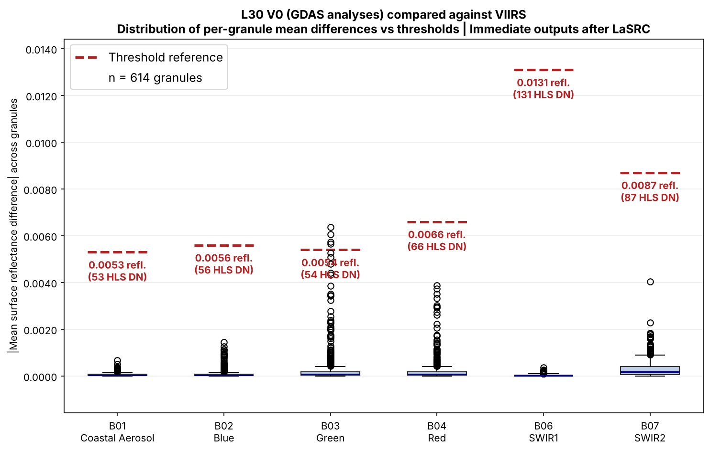
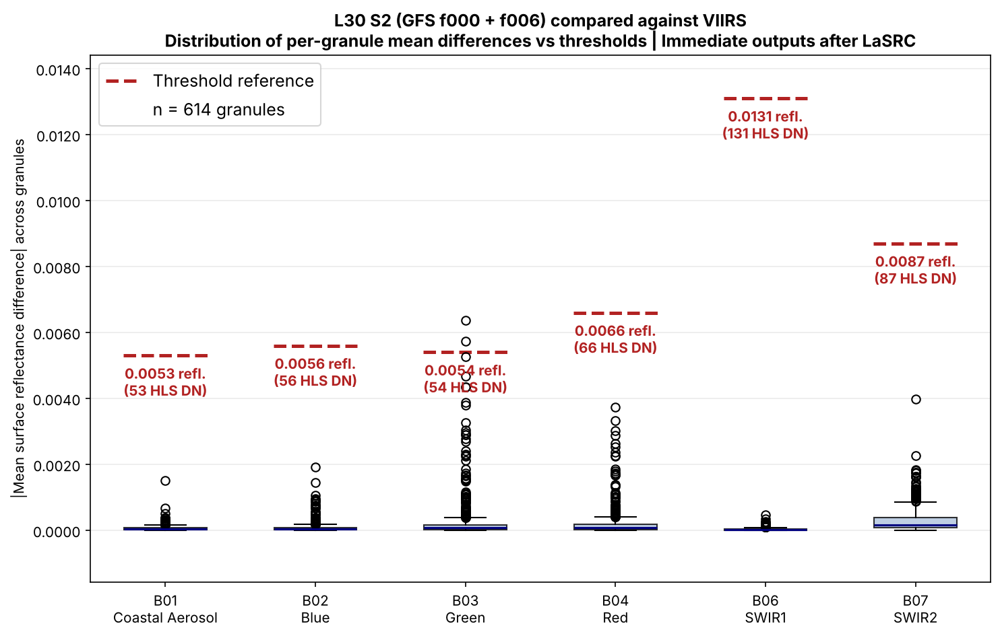
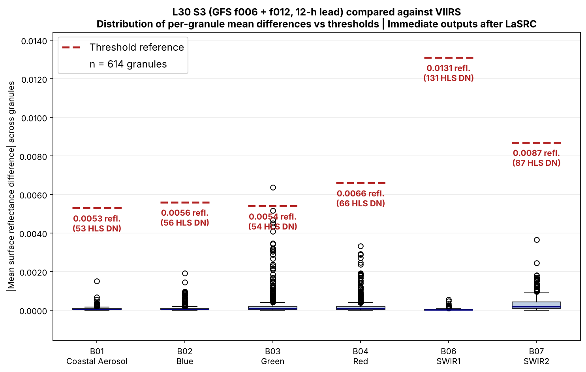
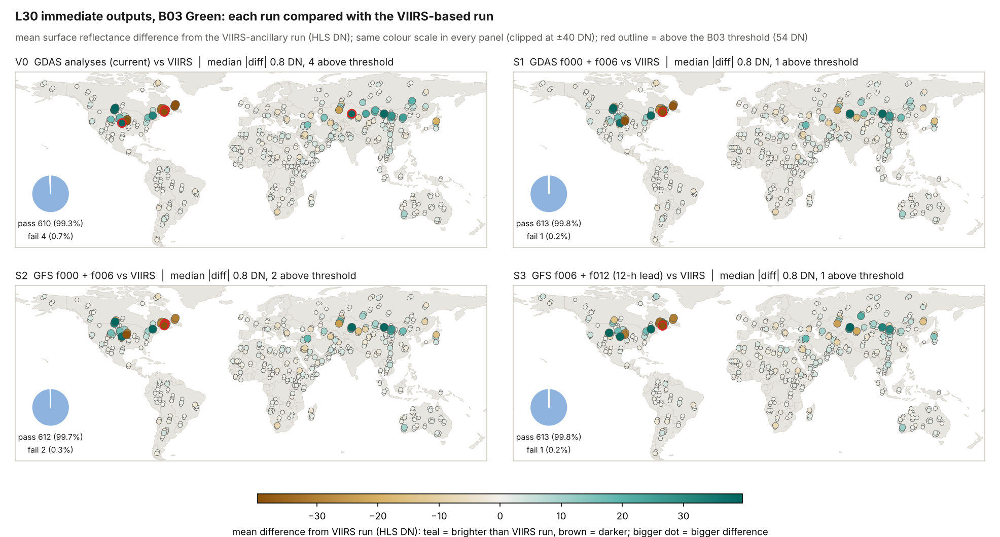
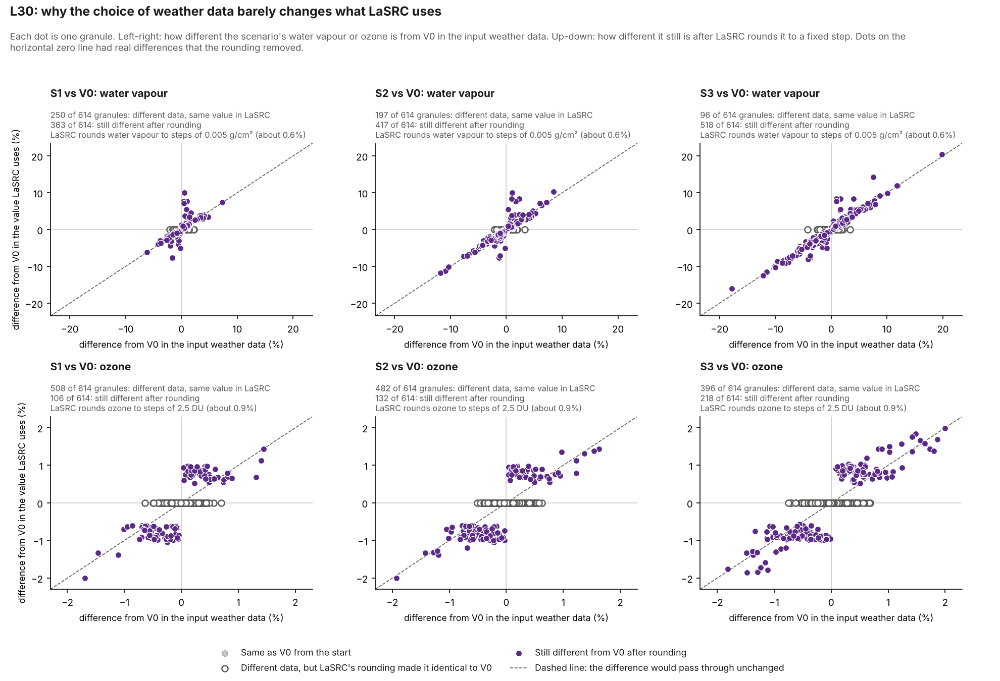
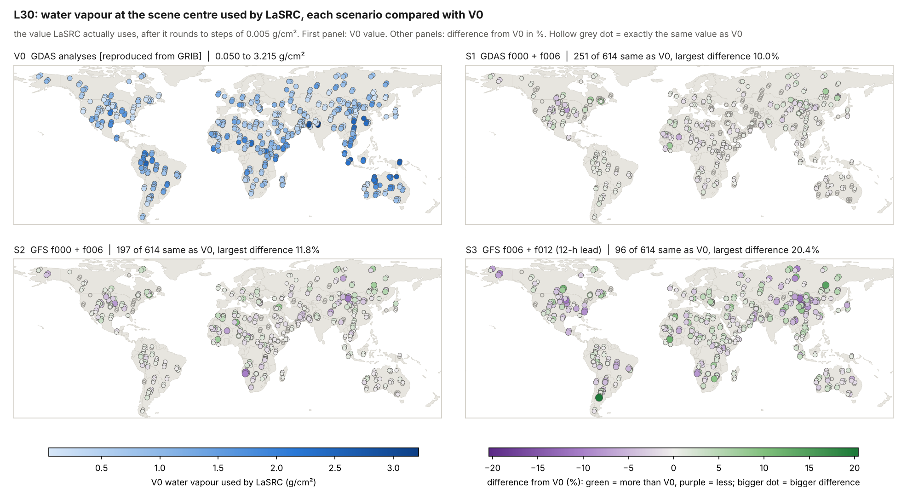
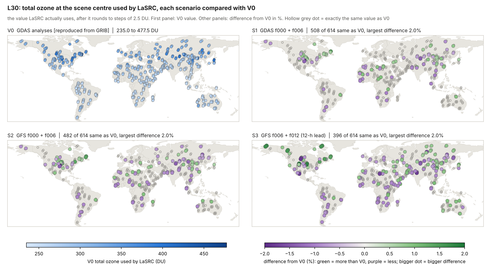
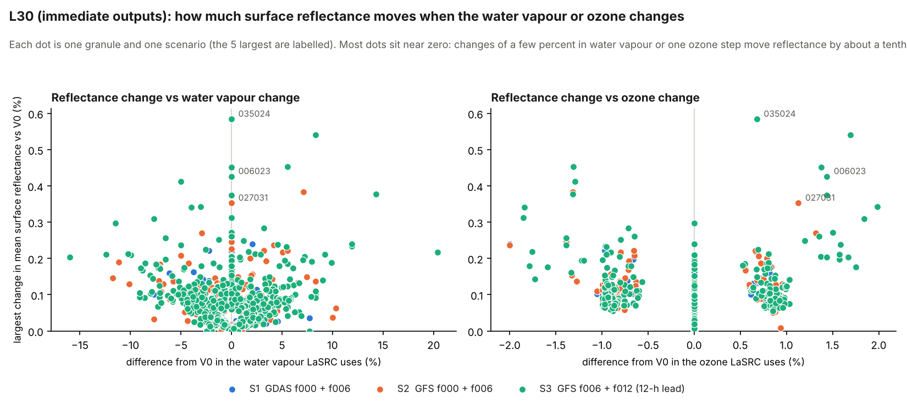

# Full-set results: low-latency ancillary sources in LaSRC, L30

Results of the large-scale test planned in [LARGE_SCALE_ANCILLARY_TEST_PLAN.md](LARGE_SCALE_ANCILLARY_TEST_PLAN.md)
for **all 614 L30 validation granules** (January and July 2025). Pilot results are in
[PILOT_ANCILLARY_LATENCY_RESULTS.md](PILOT_ANCILLARY_LATENCY_RESULTS.md); how LaSRC uses the water
vapor and ozone is in [ANCILLARY_SOURCE_COMPARISON.md](ANCILLARY_SOURCE_COMPARISON.md).

**Status:** L30 complete, validated and with the sensitivity analysis (22 Nov 2026). S30 results are in
[FULL_S30_ANCILLARY_LATENCY_RESULTS.md](FULL_S30_ANCILLARY_LATENCY_RESULTS.md).

## 1. Summary

- **All 614 × 3 scenario runs finished**, no failures.
- **Pass rate against VIIRS is unchanged or slightly better than the current GDAS run.** V0 fails
  4 of 614 granules (0.7%); S1 fails 1, S2 fails 2, S3 fails 1. All failures are B03 on January scenes,
  and every scenario failure also fails in V0.
- **Switching the weather data changes reflectance very little.** Compared with V0, no granule fails
  any band with any scenario. Median change in B03 is 0.03 DN (S1), 0.05 DN (S2) and 0.19 DN (S3),
  against a 54 DN threshold.
- **The ranking is as expected:** S1 (GDAS forecast) changes reflectance least, S2 (GFS, same cycle)
  slightly more, S3 (GFS 12-h lead) the most.
- **All larger changes are in January.** Every granule that moves more than 10 DN is a January scene
  (11 for S1, 14 for S2, 21 for S3, of 333 January granules); in July the 95th percentile is 1.6–3.4 DN
  and no granule exceeds 10 DN. The largest single change is 39.6 DN (S3, path/row 035/025,
  12 Jan 2025), about 70% of the B03 threshold.
- **Sensitivity (section 5):** the scenarios change the water vapor LaSRC uses by a median of
  0.4–1.7% and the ozone by 0.1–0.25%; LaSRC's storage step makes the ozone identical to V0 in
  65–83% of granules. Reflectance moves by a median of 0.01–0.06% (at most 0.6%). Where both values
  are identical to V0, reflectance is identical too.

## 2. What was run

| Run | File valid at C1 | File valid at C2 | Ancillary ready after acquisition |
|---|---|---|---|
| **V0** (existing validated outputs) | GDAS C1 f000 | GDAS C2 f000 | 7–13 h |
| **S1** | GDAS C1 f000 | GDAS C1 f006 | 1–7 h |
| **S2** | GFS C1 f000 | GFS C1 f006 | 0–3.6 h |
| **S3** | GFS CP f006 | GFS CP f012 | before the overpass |

- **Granules:** the 614 L30 validation granules (333 January, 281 July 2025).
- **Processing:** validated Landsat container (`hls-landsat-c2-b271310-20260722.sif`) on Meteor, same
  runner as the pilot; per-granule records of the two GRIB files and LaSRC's `uwv`, `uoz`.
- **Validation:** existing LaSRC validation CLI, immediate stage (L30 final products are HDF, which
  the CLI does not read), bands B01–B04, B06, B07, Ju et al. (2025) Table 7 thresholds. A granule
  passes a band when its |mean difference| is at or below the threshold.
- **Comparisons:** each scenario vs the VIIRS-ancillary run (as in the GDAS-vs-VIIRS validation),
  V0 vs VIIRS on the same granules, and each scenario vs V0 directly.

## 3. Against VIIRS

The validation tool's threshold boxplots, one per run, each compared against the VIIRS-based run
(per-granule |mean difference|, red dashed lines at the thresholds, n = 614 granules):

| V0 (GDAS analyses) vs VIIRS | S1 (GDAS f000 + f006) vs VIIRS |
|---|---|
|  |  |
| **S2 (GFS f000 + f006) vs VIIRS** | **S3 (GFS f006 + f012) vs VIIRS** |
|  |  |


Per-granule |mean difference| vs VIIRS, HLS DN: median / 95th percentile / pass rate.

| Band | Threshold (DN) | V0 | S1 | S2 | S3 |
|---|---|---|---|---|---|
| B01 | 53 | 0.35 / 1.8 / 100.0% | 0.36 / 1.7 / 100.0% | 0.35 / 1.7 / 100.0% | 0.36 / 1.8 / 100.0% |
| B02 | 56 | 0.37 / 3.5 / 100.0% | 0.38 / 3.0 / 100.0% | 0.36 / 3.1 / 100.0% | 0.33 / 2.8 / 100.0% |
| B03 | 54 | 0.85 / 13.6 / 99.3% | 0.81 / 11.1 / 99.8% | 0.80 / 11.1 / 99.7% | 0.81 / 11.6 / 99.8% |
| B04 | 66 | 0.85 / 8.5 / 100.0% | 0.82 / 7.1 / 100.0% | 0.75 / 7.4 / 100.0% | 0.76 / 8.0 / 100.0% |
| B06 | 131 | 0.19 / 1.1 / 100.0% | 0.18 / 1.0 / 100.0% | 0.18 / 1.0 / 100.0% | 0.20 / 1.1 / 100.0% |
| B07 | 87 | 1.78 / 10.6 / 100.0% | 1.64 / 10.8 / 100.0% | 1.66 / 10.7 / 100.0% | 1.78 / 10.6 / 100.0% |

| | V0 | S1 | S2 | S3 |
|---|---|---|---|---|
| Granules failing ≥ 1 band | 4 (0.7%) | 1 (0.2%) | 2 (0.3%) | 1 (0.2%) |

Failing granules (all B03): V0 — `LC09_L1TP_010026_20250121`, `LC09_L1TP_010027_20250121`,
`LC09_L1TP_029033_20250110`, `LC09_L1TP_150028_20250110`; S1 and S3 — `010027`; S2 — `010026`,
`010027`. These granules sit close to the threshold in V0 as well.



*B03 (green). Every run compared with the VIIRS-based run: signed mean difference in HLS DN, same
colour scale in all four panels; red outline = above the threshold; pie = share passing. The four panels are
almost identical: switching from the GDAS analyses (V0) to S1, S2 or S3 barely changes how the
results compare with VIIRS. All bands: [B01](figures/full_l30/vs_VIIRS_dn/vs_viirs_dn_L30_immediate_B01.png) · [B02](figures/full_l30/vs_VIIRS_dn/vs_viirs_dn_L30_immediate_B02.png) · [B03](figures/full_l30/vs_VIIRS_dn/vs_viirs_dn_L30_immediate_B03.png) · [B04](figures/full_l30/vs_VIIRS_dn/vs_viirs_dn_L30_immediate_B04.png) · [B06](figures/full_l30/vs_VIIRS_dn/vs_viirs_dn_L30_immediate_B06.png) · [B07](figures/full_l30/vs_VIIRS_dn/vs_viirs_dn_L30_immediate_B07.png). The same comparison as
|mean difference| in HLS DN with the threshold on the colour bar: [B01](figures/full_l30/difference_vs_VIIRS/difference_vs_viirs_L30_immediate_B01.png) · [B02](figures/full_l30/difference_vs_VIIRS/difference_vs_viirs_L30_immediate_B02.png) · [B03](figures/full_l30/difference_vs_VIIRS/difference_vs_viirs_L30_immediate_B03.png) · [B04](figures/full_l30/difference_vs_VIIRS/difference_vs_viirs_L30_immediate_B04.png) · [B06](figures/full_l30/difference_vs_VIIRS/difference_vs_viirs_L30_immediate_B06.png) · [B07](figures/full_l30/difference_vs_VIIRS/difference_vs_viirs_L30_immediate_B07.png).*

## 4. Each scenario against V0 (effect of the weather data alone)

Per-granule |mean difference| vs V0, HLS DN: median / 95th percentile / maximum. No granule fails any
band with any scenario.

| Band | S1 vs V0 | S2 vs V0 | S3 vs V0 |
|---|---|---|---|
| B01 | 0.03 / 0.3 / 15.2 | 0.04 / 0.4 / 15.2 | 0.10 / 0.6 / 15.2 |
| B02 | 0.02 / 1.1 / 19.0 | 0.04 / 1.1 / 19.0 | 0.09 / 1.4 / 19.0 |
| B03 | 0.03 / 4.8 / 22.9 | 0.05 / 5.1 / 22.6 | 0.19 / 6.1 / 39.6 |
| B04 | 0.05 / 2.7 / 17.0 | 0.08 / 2.8 / 17.0 | 0.27 / 3.6 / 27.5 |
| B06 | 0.02 / 0.1 / 4.4 | 0.02 / 0.2 / 4.4 | 0.06 / 0.3 / 5.3 |
| B07 | 0.11 / 1.0 / 6.9 | 0.19 / 1.7 / 7.9 | 0.50 / 2.6 / 6.8 |


By month (largest band per granule):

| | January (333 granules) | July (281 granules) |
|---|---|---|
| S1 vs V0 | median 0.15, 95th pct 8.0, 11 above 10 DN | median 0.19, 95th pct 1.6, none above 10 DN |
| S2 vs V0 | median 0.31, 95th pct 8.6, 14 above 10 DN | median 0.32, 95th pct 2.1, none above 10 DN |
| S3 vs V0 | median 0.92, 95th pct 10.8, 21 above 10 DN | median 0.81, 95th pct 3.4, none above 10 DN |

Largest changes vs V0: S1 22.9 DN (`LC09_L1TP_029033_20250110`), S2 22.6 DN (same granule),
S3 39.6 DN (`LC08_L1TP_035025_20250112`). Winter scenes, likely snow-covered, respond most, as T16TCK
did in the S30 pilot.

Maps of each scenario minus V0 (% of mean reflectance), per band: [B01](figures/full_l30/change_vs_V0/change_vs_v0_L30_immediate_B01.png) · [B02](figures/full_l30/change_vs_V0/change_vs_v0_L30_immediate_B02.png) · [B03](figures/full_l30/change_vs_V0/change_vs_v0_L30_immediate_B03.png) · [B04](figures/full_l30/change_vs_V0/change_vs_v0_L30_immediate_B04.png) · [B06](figures/full_l30/change_vs_V0/change_vs_v0_L30_immediate_B06.png) · [B07](figures/full_l30/change_vs_V0/change_vs_v0_L30_immediate_B07.png).

## 5. Sensitivity: reflectance change vs water vapor and ozone change

**How the values were obtained.** S1–S3: the `uwv, uoz` LaSRC logged for each run. V0: reproduced
from its two GDAS analyses with LaSRC's own steps (time interpolation, spatial interpolation to the
grid cell LaSRC uses, integer storage), as described in
[ANCILLARY_SOURCE_COMPARISON.md, section 5.1](ANCILLARY_SOURCE_COMPARISON.md#51-water-vapor-and-ozone-the-input-files-vs-what-lasrc-used)
(`scene_centre_values.py`, all 614 granules × 4 runs).

**How different are the inputs from V0?** (before LaSRC's storage step)

| | Water vapor: median / 95th pct / max | Ozone: median / max |
|---|---|---|
| S1 | 0.4% / 2.4% / 7.3% | 0.09% / 1.7% |
| S2 | 0.7% / 3.9% / 11.8% | 0.13% / 1.9% |
| S3 | 1.7% / 7.0% / 19.8% | 0.25% / 2.0% |

**How much of that reaches LaSRC?** LaSRC stores water vapor in steps of 0.005 g/cm² (about 0.6% of
a typical value) and ozone in steps of 2.5 DU (about 0.9%). After that step, the value LaSRC uses is
identical to V0 in:

| | Water vapor | Ozone | Both |
|---|---|---|---|
| S1 | 251 of 614 | 508 of 614 | 206 of 614 |
| S2 | 197 of 614 | 482 of 614 | 147 of 614 |
| S3 | 96 of 614 | 396 of 614 | 53 of 614 |



*Each dot is one granule. Left-right: difference from V0 in the input data; up-down: difference in
the value LaSRC uses. Hollow dots on the zero line had real input differences that LaSRC's rounding
removed. Ozone differences mostly fall within one storage step and disappear; water vapor differences
mostly pass through, rounded to whole steps.*

| Water vapor LaSRC used | Ozone LaSRC used |
|---|---|
|  |  |

*First panel: V0 value. Other panels: each scenario's difference from V0 in % (hollow grey = same
value as V0).*

**How much does reflectance move?** Largest change in mean surface reflectance vs V0 over the six
bands, per granule:

| | Median | 95th pct | Max |
|---|---|---|---|
| S1 | 0.012% | 0.13% | 0.58% |
| S2 | 0.020% | 0.15% | 0.58% |
| S3 | 0.063% | 0.21% | 0.58% |



*Each dot is one granule and scenario. Changes of a few percent in water vapor, or one ozone step,
move reflectance by about 0.1% or less. The largest changes are all January scenes.*

**Consistency check.** Where both values LaSRC uses are identical to V0 (206, 147 and 53 granules),
the reflectance change is zero to within 0.02% (median 0.000%). So every reflectance difference
between a scenario and V0 comes from the water vapor and ozone LaSRC uses, and the reproduced V0
values match the original run.

**Why so small.** LaSRC uses water vapor and ozone only for the gas absorption in each band, and the HLS bands sit in atmospheric windows; see [LASRC_GAS_SENSITIVITY.md](LASRC_GAS_SENSITIVITY.md) for the formulas, per-band sensitivity and a check against these runs.

**What this means.** The low-latency options change the water vapor and ozone LaSRC uses by about
half a percent to two percent typically, and LaSRC's coarse storage removes most ozone differences.
The resulting reflectance change is about 0.01–0.06% typically and at most 0.6%, far below the
validation thresholds (54–131 DN, i.e. 0.0054–0.0131 in reflectance).

## 6. Next steps

1. S30: complete the run (expected Sunday 22 Nov), validate, and add the same sections.
2. Look at the January scenes with the largest changes (aerosol retrieval over snow).

## 7. Reproducing

On Meteor, root `/rtmp/tvo/LaSRC_ancillary_latency_20261120`:

```bash
R=/rtmp/tvo/LaSRC_ancillary_latency_20261120
TRIM=yes bash $R/scripts/submit.sh full both                                        # S1-S3 runs
VAL_OUT=$R/validation_full PRODUCTS=L30 REFS="VIIRS V0" STAGES=immediate SUBMIT=1 bash $R/scripts/validate.sh
sbatch --export=NONE,CONFIG_JSON=$R/validation/configs_v0/L30_V0_vs_VIIRS_immediate_full.json \
  /nas/rstor/tvo/LaSRC_validation/run_lasrc_validation_meteor.slurm                 # V0 vs VIIRS
python3 $R/scripts/status.py                                                         # progress
python $R/scripts/scene_centre_values.py --root $R --products l30 --scenario V0 --write   # V0 uwv/uoz
python $R/scripts/scene_centre_values.py --root $R --products l30 --table $R/reports_full/scene_centre_values_l30.csv
python $R/scripts/plot_pilot_difference_map.py --root $R --validation-dir validation_full \
  --out $R/reports_full/maps --anc-table $R/reports_full/scene_centre_values_l30.csv
python $R/scripts/plot_sensitivity_scatter.py --change $R/reports_full/maps/change_vs_v0_percent.csv \
  --table $R/reports_full/scene_centre_values_l30.csv --out $R/reports_full/maps/sensitivity
```
