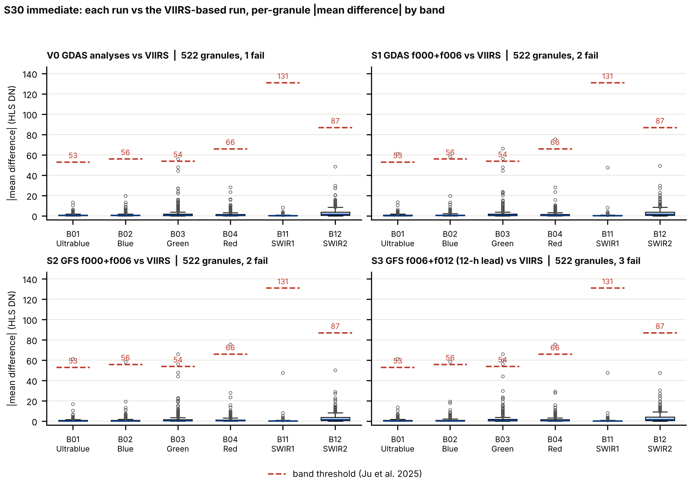
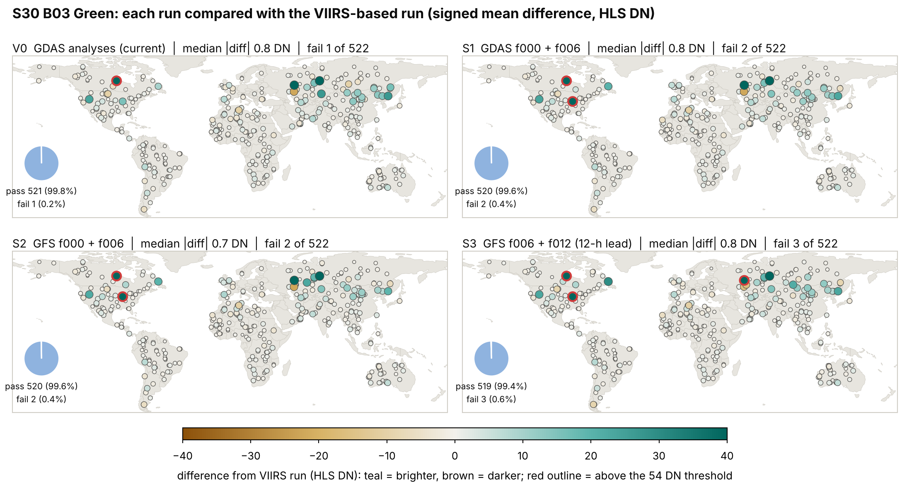
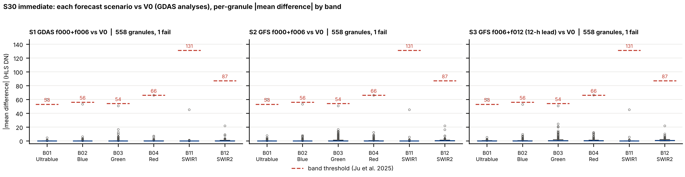
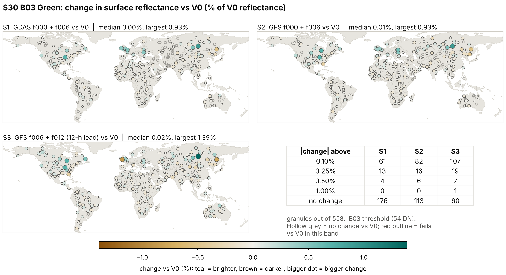
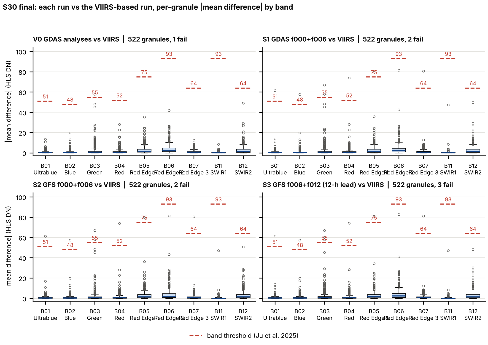
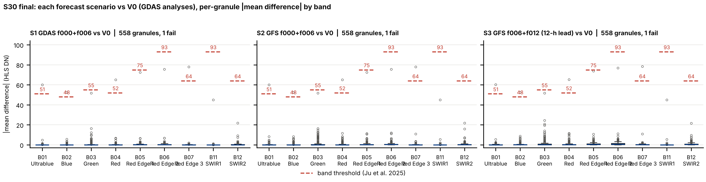

# Full-set results: low-latency ancillary sources in LaSRC, S30

Results of the large-scale test planned in [LARGE_SCALE_ANCILLARY_TEST_PLAN.md](LARGE_SCALE_ANCILLARY_TEST_PLAN.md)
for the **S30 (Sentinel-2) validation granules** (January and July 2025). The L30 results, with the
same scenarios and layout, are in [FULL_L30_ANCILLARY_LATENCY_RESULTS.md](FULL_L30_ANCILLARY_LATENCY_RESULTS.md);
why the forecast inputs change reflectance so little is in [LASRC_GAS_SENSITIVITY.md](LASRC_GAS_SENSITIVITY.md).

**Status:** S30 processed and validated, immediate and final stages (23 Nov 2026). One granule
(T16TCK) is still being investigated (section 5).

## 1. Summary

- **603 of 605 granules processed** in every scenario (two input zips are damaged; not a scenario
  issue). 522 of them have a VIIRS-ancillary baseline and 558 a V0 (GDAS analysis) baseline.
- **Against VIIRS the result matches the current GDAS run.** V0 fails 1 of 522 granules, S1 and S2
  fail 2, S3 fails 3. T15VVD fails B03 in every run, V0 included; the extra failures are T16TCK
  (S1–S3) and T39UXV (S3 only, B03 just over the threshold, a very bright scene).
- **Against V0, a single granule fails, and identically in S1, S2 and S3:** T16TCK (9 Jan 2025,
  snow-covered), immediate stage B01 and B04 (+60 / +66 DN; B04 is 0.3 DN over the threshold). Its
  cause is not settled yet (section 5).
- **Everywhere else the change is small.** Median B03 change vs V0 is 0.04 / 0.07 / 0.18 DN
  (S1 / S2 / S3), i.e. 0.00–0.02% of reflectance. Apart from T16TCK the largest B03 change is 25 DN
  (1.4%, a dark scene). All changes above 10 DN are January scenes except one (S3, July).
- **Same ranking as L30:** S1 changes reflectance least, S2 slightly more, S3 (12-h lead) the most.
- **Final stage (HLS S30 products, 9 bands with thresholds) gives the same failing granules.**

## 2. What was run

| Run | File valid at C1 | File valid at C2 | Ancillary ready after acquisition |
|---|---|---|---|
| **V0** (existing validated outputs) | GDAS C1 f000 | GDAS C2 f000 | 7–13 h |
| **S1** | GDAS C1 f000 | GDAS C1 f006 | 1–7 h |
| **S2** | GFS C1 f000 | GFS C1 f006 | 0–3.6 h |
| **S3** | GFS C1−6 h f006 | GFS C1−6 h f012 | before the overpass |

- **Granules:** 605 S30 validation granules; 603 processed (January and July 2025). With a V0
  baseline: 558 (257 January, 301 July); with a VIIRS baseline: 522 (221 January, 301 July).
- **Processing:** same S30 container and Meteor runner as the pilot; per-granule records of the two
  GRIB files and LaSRC's `uwv`, `uoz`. All runs used the intended files
  ([ANCILLARY_INPUT_VERIFICATION.md](ANCILLARY_INPUT_VERIFICATION.md)).
- **Validation:** existing LaSRC validation CLI, Ju et al. (2025) thresholds.
  - **Immediate** (LaSRC output): B01–B04, B11, B12.
  - **Final** (HLS S30 product): B01–B07, B11, B12 (B08–B10 have no threshold).
  - A granule passes a band when its |mean difference| is at or below the threshold, over the pixels
    with data in both images (fill excluded; clouds and snow are not masked).
- **Comparisons:** each run vs the VIIRS-ancillary run, and each scenario vs V0 directly.

## 3. Against VIIRS

Per-granule |mean difference| vs VIIRS by band, red dashed lines at the thresholds (immediate stage):



Per-granule |mean difference| vs VIIRS, HLS DN: median / 95th percentile / pass rate (immediate).

| Band | Threshold (DN) | V0 | S1 | S2 | S3 |
|---|---|---|---|---|---|
| B01 | 53 | 0.38 / 2.7 / 100.0% | 0.37 / 2.9 / 99.8% | 0.36 / 2.9 / 99.8% | 0.38 / 2.9 / 99.8% |
| B02 | 56 | 0.43 / 3.2 / 100.0% | 0.41 / 3.0 / 99.8% | 0.39 / 2.9 / 99.8% | 0.44 / 3.1 / 99.8% |
| B03 | 54 | 0.79 / 8.0 / 99.8% | 0.78 / 6.5 / 99.6% | 0.71 / 6.3 / 99.6% | 0.79 / 8.5 / 99.4% |
| B04 | 66 | 0.62 / 4.7 / 100.0% | 0.59 / 4.6 / 99.8% | 0.59 / 4.6 / 99.8% | 0.64 / 4.5 / 99.8% |
| B11 | 131 | 0.19 / 1.0 / 100.0% | 0.18 / 1.1 / 100.0% | 0.17 / 1.0 / 100.0% | 0.18 / 1.1 / 100.0% |
| B12 | 87 | 1.57 / 9.4 / 100.0% | 1.51 / 9.5 / 100.0% | 1.49 / 9.9 / 100.0% | 1.56 / 9.9 / 100.0% |

| | V0 | S1 | S2 | S3 |
|---|---|---|---|---|
| Granules failing ≥ 1 band (immediate) | 1 (0.2%) | 2 (0.4%) | 2 (0.4%) | 3 (0.6%) |
| Granules failing ≥ 1 band (final) | 1 | 2 | 2 | 3 |

Failing granules:

- `T15VVD_20250127` (all runs, B03, 56 DN; mean green reflectance 0.63, snow): close to the threshold
  in V0 as well.
- `T16TCK_20250109` (S1, S2, S3; B01–B04, 58–76 DN): passes in V0; see section 5.
- `T39UXV_20250122` (S3 only, B03, 60 DN on a scene with mean green reflectance 1.07, i.e. 0.6%).

Where the B03 differences are (signed difference from the VIIRS run; red outline = above threshold):



The larger differences are winter scenes in Canada and Russia, in every run including V0.

## 4. Each scenario against V0 (effect of the weather data alone)



Per-granule |mean difference| vs V0, HLS DN: median / 95th percentile / pass rate (immediate).

| Band | Threshold (DN) | S1 | S2 | S3 |
|---|---|---|---|---|
| B01 | 53 | 0.04 / 0.4 / 99.8% | 0.07 / 0.5 / 99.8% | 0.12 / 0.8 / 99.8% |
| B02 | 56 | 0.03 / 0.8 / 100.0% | 0.06 / 1.0 / 100.0% | 0.14 / 1.3 / 100.0% |
| B03 | 54 | 0.04 / 2.2 / 100.0% | 0.07 / 2.5 / 100.0% | 0.18 / 3.5 / 100.0% |
| B04 | 66 | 0.06 / 1.2 / 99.8% | 0.10 / 1.5 / 99.8% | 0.22 / 1.6 / 99.8% |
| B11 | 131 | 0.02 / 0.2 / 100.0% | 0.03 / 0.2 / 100.0% | 0.06 / 0.4 / 100.0% |
| B12 | 87 | 0.13 / 1.3 / 100.0% | 0.22 / 1.7 / 100.0% | 0.50 / 2.8 / 100.0% |

B03 change in % of V0's reflectance (hollow grey = no change at all):



| B03, vs V0 | S1 | S2 | S3 |
|---|---|---|---|
| No change at all | 176 | 113 | 60 |
| \|change\| > 0.25% | 13 | 16 | 19 |
| \|change\| > 0.5% | 4 | 6 | 7 |
| \|change\| > 1% | 0 | 0 | 1 |
| Largest | 0.93% | 0.93% | 1.39% |
| Granules > 10 DN (January / July) | 4 / 0 | 8 / 0 | 9 / 1 |

In July the 95th percentile of the B03 change is 1.1–1.7 DN. As in L30, larger changes come from bright
winter scenes, where the same relative change is more DN, and from a few dark scenes in %.

## 5. T16TCK (9 Jan 2025): the one granule that fails against V0

| Band (immediate) | Change vs V0 | % of V0 reflectance | Threshold | |
|---|---|---|---|---|
| B01 | +60 DN | +0.8% | 53 DN | fail |
| B02 | +53 DN | +0.7% | 56 DN | pass |
| B03 | +51 DN | +0.7% | 54 DN | pass |
| B04 | +66.3 DN | +0.9% | 66 DN | fail |
| B11 | −45 DN | −5.4% | 131 DN | pass |
| B12 | −22 DN | −2.4% | 87 DN | pass |

- The scene is snow-covered (mean reflectance ≈ 0.72–0.75 in the visible bands).
- **The change is the same in S1, S2 and S3** to within 0.2 DN, although S3 used different files.
- **The inputs:** V0 used `uwv` 0.28 and `uoz` 0.315; S1 and S2 used 0.28 and 0.3125 (one ozone step,
  −0.8%); S3 used 0.285 and 0.3125. A one-step ozone change alone would move green by about 0.06%
  (section 3 of [LASRC_GAS_SENSITIVITY.md](LASRC_GAS_SENSITIVITY.md)), ten times less than observed.
- **The pattern** (all visible bands brighter by 0.7–0.9%, SWIR darker by 2–5%) is what a different
  aerosol retrieval produces, not a gas-absorption change.
- **Two explanations remain open:**
  1. the ozone step tips LaSRC's aerosol retrieval on this bright snow scene (the same granule
     behaved unusually in the S30 pilot);
  2. a run-setup difference between the V0 baseline (produced earlier, in a separate run) and the
     scenario runs. The V0 run record has no aerosol-window entry, while the scenario records
     report `6x6`.
- **Next check:** rerun T16TCK with V0's own GDAS files through the current runner. If it reproduces
  V0, explanation 1 holds; if it reproduces S1–S3, the difference is the run setup.

## 6. Final stage

The final HLS S30 products give the same picture (summary tables in
[figures/full_s30/S30_final_summary.csv](figures/full_s30/S30_final_summary.csv)):

- Against VIIRS: V0 fails 1, S1 2, S2 2, S3 3, the same granules as the immediate stage.
- Against V0: only T16TCK fails (B01, B02, B04, B07; the final-stage thresholds are tighter).





## 7. Reproducing

```bash
R=/rtmp/tvo/LaSRC_ancillary_latency_20261120
# validation (configs for all 14 S30 comparisons; immediate and final)
PRODUCTS="S30" SUBMIT=1 bash $R/scripts/validate.sh
# boxplots and summary tables (sections 3, 4, 6)
python $R/scripts/validation_boxplots.py --product S30 --stage immediate --out $R/reports_full/validation_s30
python $R/scripts/validation_boxplots.py --product S30 --stage final     --out $R/reports_full/validation_s30
# B03 maps (sections 3, 4); granule locations = MGRS tile centres
python $R/scripts/slide_maps_s30.py --root $R --out $R/reports_full/validation_s30
```

Scripts are copied in [tools/](tools/). Per-band tables and every failing granule/band:
[S30_immediate_summary.csv](figures/full_s30/S30_immediate_summary.csv),
[S30_immediate_fails.csv](figures/full_s30/S30_immediate_fails.csv),
[S30_final_summary.csv](figures/full_s30/S30_final_summary.csv),
[S30_final_fails.csv](figures/full_s30/S30_final_fails.csv).
