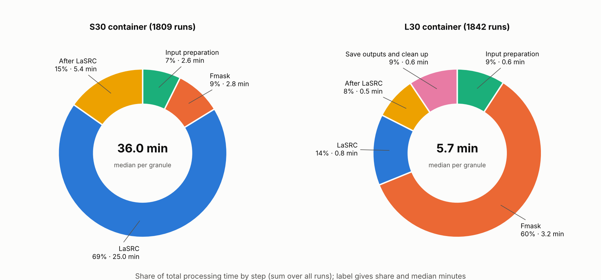
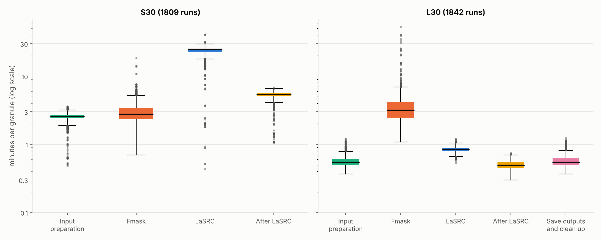
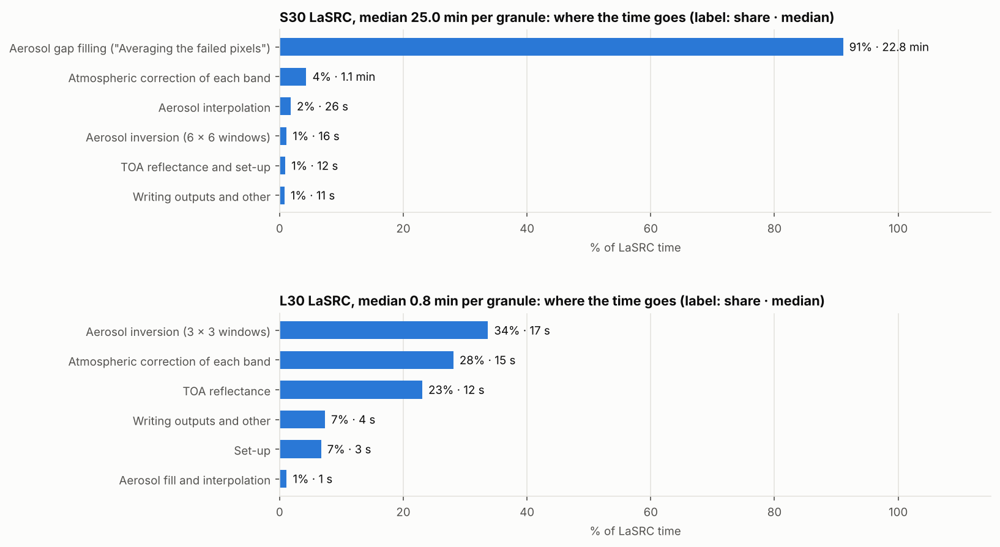
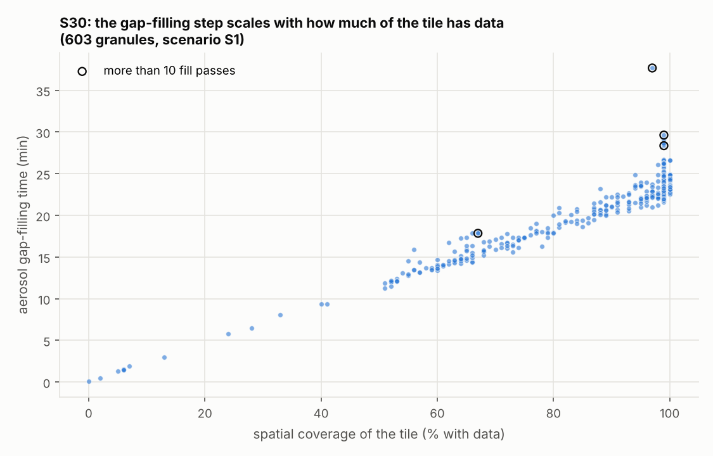

# How long each HLS processing step takes (S30 and L30 containers)

How much of the HLS processing time is LaSRC, and how much is everything else? This note measures each
step from the per-granule logs of the large-scale ancillary test: 603 S30 and 614 L30 granules, each run
three times (scenarios S1, S2 and S3), on Meteor in November 2026.

Related: [FULL_L30_ANCILLARY_LATENCY_RESULTS.md](FULL_L30_ANCILLARY_LATENCY_RESULTS.md) (the test these
runs come from).

## 1. Summary

- **"LaSRC takes about 5 minutes" is not accurate.** About 5.7 minutes is the median for the whole
  **L30 container**. LaSRC itself takes under a minute for Landsat (median 0.8 min). For Sentinel-2 it takes
  **25 minutes** (median), out of 36 minutes for the whole S30 container.
- **S30: LaSRC is 69% of the time.** Within LaSRC, one block of S30 LaSRC, the one that fills in the aerosol
  values where the retrieval failed (logged as "Averaging the failed pixels"), takes 91% of LaSRC's time
  (22.8 of 25 minutes). This block scales with how much of the tile has data: about 23 minutes for a
  full tile and a minute or two for a tile at the edge of the swath.
- **L30: Fmask is 60% of the time** (median 3.2 min). LaSRC takes 14%, and copying, format
  conversions and saving outputs take the rest.
- **The L30 container stops earlier than the S30 one.** It ends after adding the Fmask layer to the
  HDF file. The S30 container goes on through 30 m resampling, BRDF/NBAR, bandpass adjustment, COGs,
  thumbnail and metadata. Section 4 explains what this means for the comparison.
- **The ancillary source does not change the run time.** S1, S2 and S3 have the same medians to within
  0.2 minutes, and the same granule takes nearly the same time in all three runs (median spread 1.7%).
- **LaSRC was built without multi-threading.** Every log says "LaSRC was NOT compiled using
  multi-threading". A multi-threaded build is the obvious place to look for a speed-up of the S30
  gap-filling block.

## 2. Where the time goes



Each slice is that step's share of the total time summed over all runs. The label also gives the median
minutes per granule.

### S30 (1,809 runs = 603 granules × 3 scenarios)

| Step | What it includes | Median (min) | 10th–90th percentile (min) | Share of total time |
|---|---|---|---|---|
| Input preparation | copy the .SAFE zip, check sun azimuth, detector footprint, angle bands (derive_s2ang), parse Fmask, unpack, convert to ESPA | 2.6 | 1.9–2.9 | 7% |
| Fmask | Fmask 4.7 | 2.8 | 2.0–4.3 | 9% |
| **LaSRC** | TOA and surface reflectance (do_lasrc_sentinel.py) | **25.0** | 16.4–26.7 | **69%** |
| After LaSRC | ESPA to HDF, combine, add Fmask, trim, 30 m resampling (create_s2at30m), BRDF/NBAR (derive_s2nbar), bandpass (L8like), COGs, thumbnail, metadata | 5.4 | 3.9–5.9 | 15% |
| **Total** | | **36.0** | 24.6–38.8 | 100% |

### L30 (1,842 runs = 614 granules × 3 scenarios)

| Step | What it includes | Median (min) | 10th–90th percentile (min) | Share of total time |
|---|---|---|---|---|
| Input preparation | copy the L1 scene, check sun azimuth, Fmask to binary, TIFs to scanline, convert to ESPA | 0.6 | 0.5–0.7 | 9% |
| **Fmask** | Fmask 4.7 | **3.2** | 2.0–5.1 | **60%** |
| LaSRC | TOA and surface reflectance (do_lasrc_landsat.py) | 0.8 | 0.7–1.0 | 14% |
| After LaSRC | rename angle bands, ESPA XML, ESPA to HDF, addFmaskSDS | 0.5 | 0.4–0.6 | 8% |
| Save outputs and clean up | copy the outputs (about 8 GB) to the output folder, clear scratch | 0.6 | 0.5–0.8 | 9% |
| **Total** | | **5.7** | 4.4–7.8 | 100% |



The spread per step (log scale) shows that Fmask varies the most. A few L30 scenes take 20–50 minutes
in Fmask. S30 LaSRC has a group of fast runs: these are partly covered tiles (section 3).

## 3. Inside LaSRC

LaSRC prints a time at the start of each of its stages, so its time can be split further:



| LaSRC stage | S30 median | S30 share | L30 median | L30 share |
|---|---|---|---|---|
| TOA reflectance and set-up | 12 s | 1% | 15 s | 30% |
| Aerosol inversion (S30: 6 × 6 windows, L30: 3 × 3 windows) | 16 s | 1% | 17 s | 34% |
| Aerosol interpolation (and, for S30, "Expand the failed pixels") | 26 s | 2% | 1 s | 1% |
| **Aerosol gap filling: "Averaging the failed pixels" (S30 only)** | **22.8 min** | **91%** | – | – |
| Atmospheric correction of each band | 1.1 min | 4% | 15 s | 28% |
| Writing outputs and other | 11 s | 1% | 4 s | 7% |
| **LaSRC total** | **25.0 min** | | **0.8 min** | |

Every stage except one takes about the same time for both sensors, within seconds or about a minute.
The difference is the S30 gap-filling block. It runs from LaSRC's "Averaging the failed pixels"
message until "Performing atmospheric correction". LaSRC prints nothing in between except its fill
passes, so this block cannot be split further from the logs. The Landsat version has no such block: its
aerosol fill ("Filling invalid aerosol values in the 3x3 windows") takes about a second.

**What sets the length of the S30 block:** the amount of the tile that has data. The fill counts in the
log are in 10 m pixels (up to 120 million per tile), and the time rises in a straight line with the
tile's spatial coverage:



| Spatial coverage of the tile | Granules × scenarios | Median gap-filling time |
|---|---|---|
| 0–25% | 27 | 1.5 min |
| 25–50% | 12 | 8.6 min |
| 50–75% | 288 | 14.9 min |
| 75–95% | 255 | 20.4 min |
| 95–100% | 1,227 | 23.1 min |

Cloud cover makes almost no difference (rank correlation −0.05). Most scenes need only 2 fill passes.
The 4 granules that need more than 10 (circled) take 3–15 minutes longer than other granules with the
same coverage. The longest is T18FYL (2025-07-25): 46 passes, 38 min.

## 4. What the two containers cover

| HLS step | S30 container | L30 container |
|---|---|---|
| Fmask | yes | yes |
| LaSRC (TOA and surface reflectance) | yes | yes |
| HDF with the Fmask layer | yes | yes |
| Resampling to the 30 m MGRS tile | yes (create_s2at30m) | **no** |
| BRDF/NBAR adjustment | yes (derive_s2nbar) | **no** |
| Bandpass adjustment | yes (L8like) | not needed for L30 |
| COGs, thumbnail, metadata | yes | **no** |

The L30 times therefore cover only the steps up to and including LaSRC. Tiling, NBAR and COG for
Landsat are not in this container and are not measured here. For S30, the post-LaSRC steps print no
times, so they appear as one block of 5.4 minutes (15%). Their individual times would need timestamps
added to the S30 wrapper (section 6).

## 5. How the times were measured, and caveats

- **Source:** the per-granule logs `logs/<product>/<scenario>/<granule>.log`, which hold the container's
  output.
- **Which times are used.** Only times printed in the logs are used; nothing is estimated.
  - **L30:** the wrapper stamps every step (`[2026-11-19 21:46:38] Run LaSRC`). Each step lasts until the
    next stamp.
  - **S30:** the steps come from five sources:
    - container start and end (`sentinel_start=`, `sentinel_end=`);
    - Fmask's own "finished (X minutes)";
    - the first `unpackage_s2.py` message;
    - the `do_lasrc_sentinel.py` start and "Completion of surface reflectance" messages;
    - LaSRC's internal stage times.

    "Input preparation" is the time from container start to unpacking, minus Fmask, plus unpacking
    and conversion to the LaSRC start.
  - **LaSRC stages:** each stage lasts until the next stage message.
  - **Check:** for every run, the steps add up to the container total (L30 to within 1 s, S30 exactly).
- **Wall-clock times on shared nodes.** Several jobs ran on the same node at once, mostly meteor157,
  so the times include some competition for CPU and disk. The same granule took nearly the same time in
  S1, S2 and S3, which ran at different times (median spread 1.7%), so the effect is small. Nodes
  differ slightly: the median S30 run took 36 min on meteor157 and 41 min on meteor156.
- **Excluded runs:** the 2 S30 granules with damaged input zips have no timing (603 of 605 granules).
  The 10 pilot granules use their pilot-run logs.
- **GRIB auxiliary mode.** All runs used GRIB ancillary data. The aerosol steps do not depend on the
  ancillary source, so VIIRS runs should take about the same time, but this was not measured here.

## 6. Suggestions

- **For S30 speed:** the aerosol gap-filling block in LaSRC is where the time is: 23 of 36 minutes for
  a full tile. Two directions to look at:
  - a multi-threaded LaSRC build;
  - the fill algorithm itself, which runs over every 10 m pixel.

  A 2× speed-up of that block would cut the S30 container time by about a third.
- **For L30 speed:** Fmask is the largest step. LaSRC is not a bottleneck for Landsat.
- **For finer timing:** add a timestamp before each step of the S30 wrapper, as the L30 wrapper
  already does. For example, prefix each `echo "Running ..."` with `date`. That would split the
  5.4-minute post-LaSRC block into HDF, resampling, NBAR, bandpass and COG.

## 7. Reproducing

On Meteor, from the login node (matplotlib is not installed on compute nodes):

```bash
R=/rtmp/tvo/LaSRC_ancillary_latency_20261120
python3 $R/scripts/step_timing.py --root $R --products s30 --out $R/reports_full/step_timing/step_timing_s30.csv
python3 $R/scripts/step_timing.py --root $R --products l30 --out $R/reports_full/step_timing/step_timing_l30.csv
python3 $R/scripts/plot_step_timing.py \
  --s30 $R/reports_full/step_timing/step_timing_s30.csv \
  --l30 $R/reports_full/step_timing/step_timing_l30.csv \
  --out $R/reports_full/step_timing/figures      # also prints the tables above
```

`step_timing.py` writes one row per run with one column per step in seconds. S30 rows also include the
number of fill passes, the unfilled pixels at pass 2, spatial coverage and cloud coverage.
