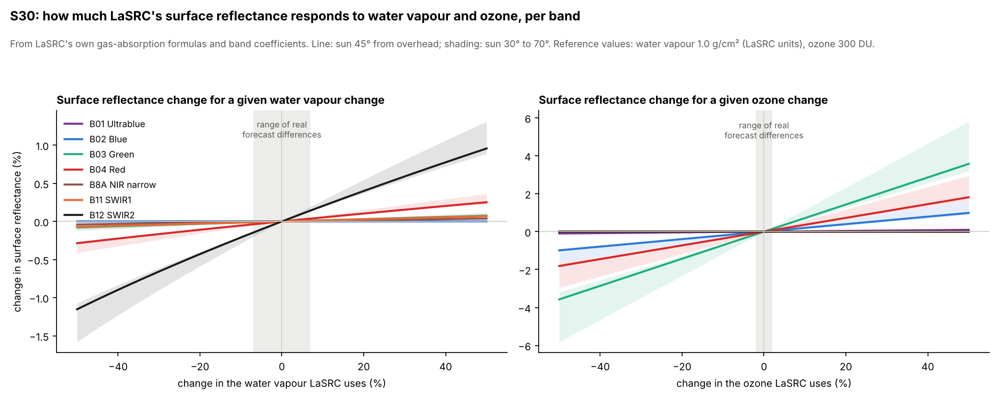

# How sensitive is LaSRC surface reflectance to water vapor and ozone?

Why can the water vapor given to LaSRC change by up to 20% between ancillary sources while surface
reflectance barely moves? This note explains how LaSRC uses the two values, shows from LaSRC's own
formulas how much each band responds, checks that prediction against all 614 L30 granules of the
large-scale test, and gives the input error that would be needed to fail validation.

Related: [FULL_L30_ANCILLARY_LATENCY_RESULTS.md](FULL_L30_ANCILLARY_LATENCY_RESULTS.md) (results),
[ANCILLARY_SOURCE_COMPARISON.md](ANCILLARY_SOURCE_COMPARISON.md) (how the GRIB files become the two
values), [ANCILLARY_INPUT_VERIFICATION.md](ANCILLARY_INPUT_VERIFICATION.md) (checking the input files).

## 1. Summary

- **LaSRC uses water vapor and ozone only to correct for gas absorption.** It converts them into a
  transmittance per band (how much light the gas lets through) and divides the satellite signal by it.
  A change in water vapor or ozone changes surface reflectance by about as much as it changes that
  transmittance.
- **The HLS bands sit in atmospheric windows,** where these gases absorb very little. A 20% change in
  water vapor changes reflectance by at most 0.4% (SWIR2) and by 0.00–0.12% in the other bands. A 20%
  change in ozone changes green by 1.4%, red by 0.7–0.9%, blue by 0.3–0.4%, and the other bands by
  almost nothing.
- **The real differences between ancillary sources are much smaller than 20%** for most granules
  (typically 0.4–1.7% for water vapor and 0.1–0.25% for ozone), which predicts reflectance changes of
  hundredths of a percent. That is what the full L30 run measured.
- **The prediction matches the measurements.** For the three bands where the gases absorb (green, red,
  SWIR2), the reflectance change predicted from each granule's water vapor and ozone change agrees
  with the measured change (correlation 0.93–0.99 over 1,842 granule-scenario pairs).
- **To fail validation, the inputs would have to be far off:** ozone by about +67% (green) or
  +104% (red), water vapor by about +360% (SWIR2); in the other bands no realistic error is enough.

## 2. How LaSRC uses water vapor and ozone

LaSRC reduces the GRIB fields to **one water vapor value (`uwv`) and one ozone value (`uoz`) per
scene** (see [ANCILLARY_SOURCE_COMPARISON.md, section 5.1](ANCILLARY_SOURCE_COMPARISON.md#51-water-vapor-and-ozone-the-input-files-vs-what-lasrc-used)).
They enter the correction in one place, the gas transmittance (`comptg` in `lut_subr.c`):

```text
air-mass factor:            m    = 1/cos(sun zenith) + 1/cos(view zenith)
ozone transmittance:        T_oz = exp( a_oz[band] · m · uoz )
water vapor transmittance:  T_wv = exp( −a_wv[band] · (m · uwv) ^ b_wv[band] )
```

The surface reflectance is then computed from the satellite reflectance divided by these
transmittances (together with the Rayleigh and aerosol terms, which do not depend on `uwv` or `uoz`).
So, to first order:

```text
relative change in surface reflectance  ≈  − [ change in ln T_oz  +  change in ln T_wv ]
```

In plain words: the more a gas absorbs in a band, the more LaSRC corrects for it, and the more an
error in that gas matters. The amount of absorption in each band is fixed by its coefficients,
derived from radiative-transfer calculations (6S) and hard-coded in LaSRC:

| L30 band | a_oz (ozone) | a_wv (water vapor) | b_wv | Gas that matters |
|---|---|---|---|---|
| B01 Ultrablue | −0.0026 | ~0 | 1.00 | (almost none) |
| B02 Blue | −0.018 | ~0 | 1.00 | ozone, a little |
| B03 Green | −0.097 | 0.0019 | 0.78 | **ozone** |
| B04 Red | −0.061 | 0.0040 | 0.77 | **ozone**, some water vapor |
| B05 NIR | ~0 | 0.0007 | 0.89 | (almost none) |
| B06 SWIR1 | ~0 | 0.0007 | 0.94 | (almost none) |
| B07 SWIR2 | ~0 | 0.0178 | 0.65 | **water vapor** |

Sentinel-2 (S30) has similar values: ozone matters in B02–B04, water vapor mainly in B12 (SWIR2),
with smaller amounts in B04, B8A and B11 (coefficients in `compute_sentinel_refl.c`).

Two further details reduce the effect:

- **One value per scene.** Differences inside the scene, which the maps of the GRIB fields show,
  play no part.
- **Rounding.** LaSRC stores water vapor in steps of 0.005 g/cm² and ozone in steps of 2.5 DU, so
  small input differences often disappear entirely (shown in
  [FULL_L30_ANCILLARY_LATENCY_RESULTS.md, section 5](FULL_L30_ANCILLARY_LATENCY_RESULTS.md#5-sensitivity-reflectance-change-vs-water-vapor-and-ozone-change)).

## 3. Sensitivity of each band

Reflectance change for a given change in the water vapor or ozone LaSRC uses, from the formulas and
coefficients above. Reference values: water vapor 1.0 g/cm² (in LaSRC's units), ozone 300 DU, sun 45°
from overhead (shading: 30° to 70°). The grey band marks the range of real differences between the
ancillary sources.




| | +20% water vapor | +20% ozone | one ozone step (2.5 DU) | one water vapor step (0.005 g/cm²) |
|---|---|---|---|---|
| L30 B01 Ultrablue | 0.00% | 0.04% | 0.002% | 0.000% |
| L30 B02 Blue | 0.00% | 0.26% | 0.011% | 0.000% |
| L30 B03 Green | 0.06% | 1.40% | 0.059% | 0.002% |
| L30 B04 Red | 0.12% | 0.89% | 0.037% | 0.003% |
| L30 B05 NIR | 0.03% | 0.00% | 0.000% | 0.001% |
| L30 B06 SWIR1 | 0.03% | 0.00% | 0.000% | 0.001% |
| L30 B07 SWIR2 | 0.40% | 0.00% | 0.000% | 0.010% |
| S30 B02 Blue | 0.00% | 0.39% | 0.016% | 0.000% |
| S30 B03 Green | 0.03% | 1.43% | 0.060% | 0.001% |
| S30 B04 Red | 0.10% | 0.72% | 0.030% | 0.003% |
| S30 B8A NIR narrow | 0.02% | 0.00% | 0.000% | 0.000% |
| S30 B11 SWIR1 | 0.03% | 0.00% | 0.000% | 0.001% |
| S30 B12 SWIR2 | 0.40% | 0.00% | 0.000% | 0.010% |

The water vapor response is not proportional: because of the exponent `b_wv` < 1, the same
percentage change matters slightly more when the air is drier, and more at low sun (larger `m`).

## 4. Check against the real runs (L30, 614 granules)

For each granule and scenario, the change predicted from that granule's own water vapor and ozone
change (and its sun angle) is compared with the reflectance change actually measured between the
scenario and V0. S1–S3 values are those LaSRC logged; V0 values are reproduced from its GDAS files.


| Band | Correlation (1,842 pairs) | Within ±0.02% or ±50% of prediction |
|---|---|---|
| B03 Green | 0.94 | 88% |
| B04 Red | 0.93 | 94% |
| B07 SWIR2 | 0.99 | 99% |
| B02 Blue | 0.56 | 79% |
| B01 Ultrablue | (prediction ≈ 0) | 72% |
| B06 SWIR1 | (prediction ≈ 0) | 97% |

- **Green, red and SWIR2 follow the prediction closely.** In these bands the measured change is the
  gas-absorption effect, nothing more. Green and red come out slightly above the line, as expected:
  the first-order formula leaves out the gas absorption on the atmospheric path, which adds a little,
  especially for dark scenes.
- **Ultrablue, blue and SWIR1 show small changes (mostly within ±0.1%) where almost none is predicted.**
  These come indirectly through LaSRC's aerosol retrieval, which uses the corrected bands: a slightly
  different ozone or water vapor correction shifts the retrieved aerosol a little, and that moves every
  band. The size stays small, except on a few winter scenes (see T16TCK in the S30 pilot).

## 5. How wrong would the inputs have to be to fail validation?

The threshold of each band expressed as a percentage of a typical reflectance (median over the
614 L30 granules), and the change in the LaSRC input needed for the predicted reflectance change to
reach it (sun 45°):

| L30 band | Typical reflectance | Threshold | = % of reflectance | Water vapor change needed | Ozone change needed |
|---|---|---|---|---|---|
| B01 Ultrablue | 0.064 | 53 DN | 8.2% | > 1000% | > 1000% |
| B02 Blue | 0.076 | 56 DN | 7.4% | > 1000% | +573% |
| B03 Green | 0.116 | 54 DN | 4.7% | > 1000% | **+67%** |
| B04 Red | 0.144 | 66 DN | 4.6% | > 1000% | **+104%** |
| B06 SWIR1 | 0.228 | 131 DN | 5.8% | > 1000% | > 1000% |
| B07 SWIR2 | 0.163 | 87 DN | 5.3% | **+360%** | > 1000% |

The largest differences seen between ancillary sources in the full L30 run were 19.8% for water vapor
and 2.0% for ozone, an order of magnitude or more below these values.

## 6. Confirmation with LaSRC (proposed, not yet run)

Sections 3–5 use LaSRC's formulas plus the existing runs. A direct confirmation is to rerun a few
granules in the container with the GDAS fields deliberately shifted, so that the only thing that
changes is the input:

- **Granules:** 5 L30 and 3 S30, covering dry and humid, dark and bright, low and high sun.
- **Changes to V0's two GDAS files** (`grib2_offset_stdlib.py`, which adds a constant without
  re-encoding the data):
  - PWAT −5, +5, +10, +20 kg/m²
  - TOZNE −50, −25, +25, +50 DU
- **Runs:** 8 per granule, about 64 in total (L30 about 8 minutes each, S30 about 35 minutes).
- **Result:** for each band, measured reflectance change against the input change, drawn on top of
  the curves in section 3.

How to set it up is in [ANCILLARY_INPUT_VERIFICATION.md, section 7](ANCILLARY_INPUT_VERIFICATION.md#7-change-the-input-files):

```bash
R=/rtmp/tvo/LaSRC_ancillary_latency_20261120
# one shifted copy of a GDAS analysis (repeat for each file, field and amount)
python3 $R/scripts/grib2_offset_stdlib.py \
  /nas/rstor/tvo/GFS_2025/gdas.20250109/12/atmos/gdas.t12z.pgrb2.1p00.f000 \
  $R/ancillary_pool/gdas_pwat_p10/20250109/12/gdas.t12z.1p00.f000.grb2 --var PWAT --delta 10
# then add a scenario in select_pair.py that points to the shifted files, run the granule list with
# run_scenario.slurm, and check the inputs with audit_ancillary_inputs.py before using the results
```

The smoke test already ran one such case (P0, +10 kg/m² of water vapor at T15VVD and T43VDD), which
changed the value LaSRC used as expected.

## 7. Reproducing

```bash
R=/rtmp/tvo/LaSRC_ancillary_latency_20261120
python $R/scripts/gas_sensitivity.py --product L30 \
  --table $R/reports_full/scene_centre_values_l30.csv \
  --change $R/reports_full/maps/change_vs_v0_percent.csv \
  --v0-metrics $(ls $R/validation_full/L30_V0_vs_VIIRS_immediate/reports/lasrc_validation_metrics_*.csv | tail -1) \
  --out $R/reports_full/gas_sensitivity
python $R/scripts/gas_sensitivity.py --product S30 --out $R/reports_full/gas_sensitivity
```

The S30 check against real runs (section 4) will be added when the S30 validation is complete.
