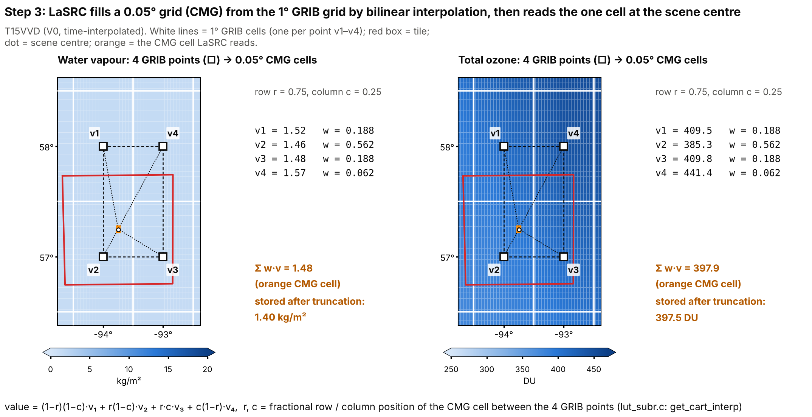
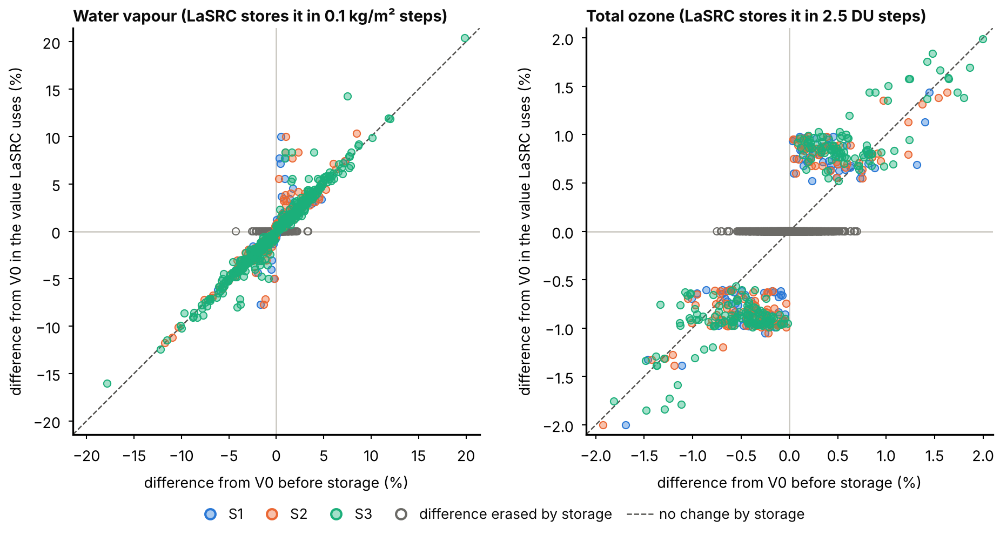
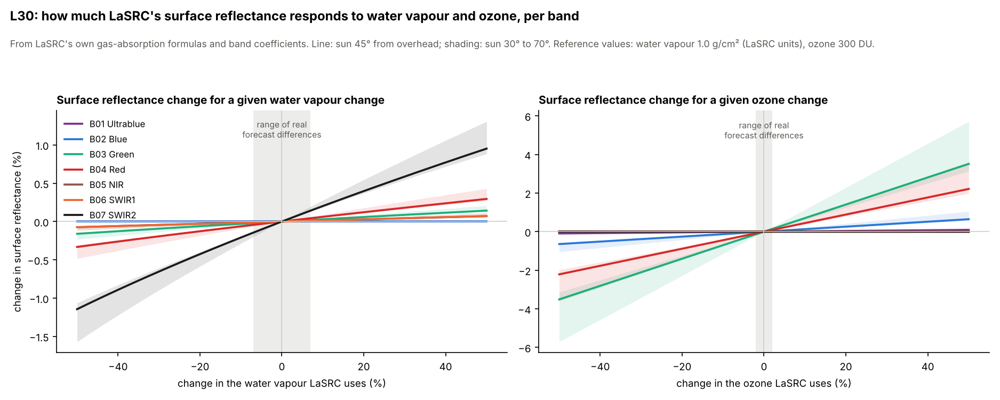
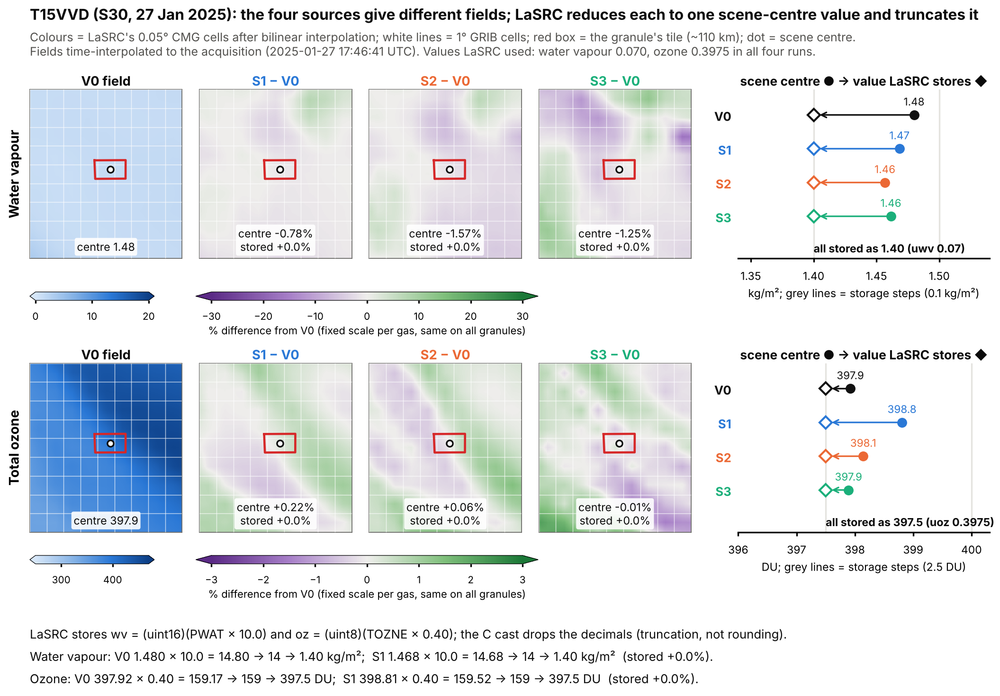
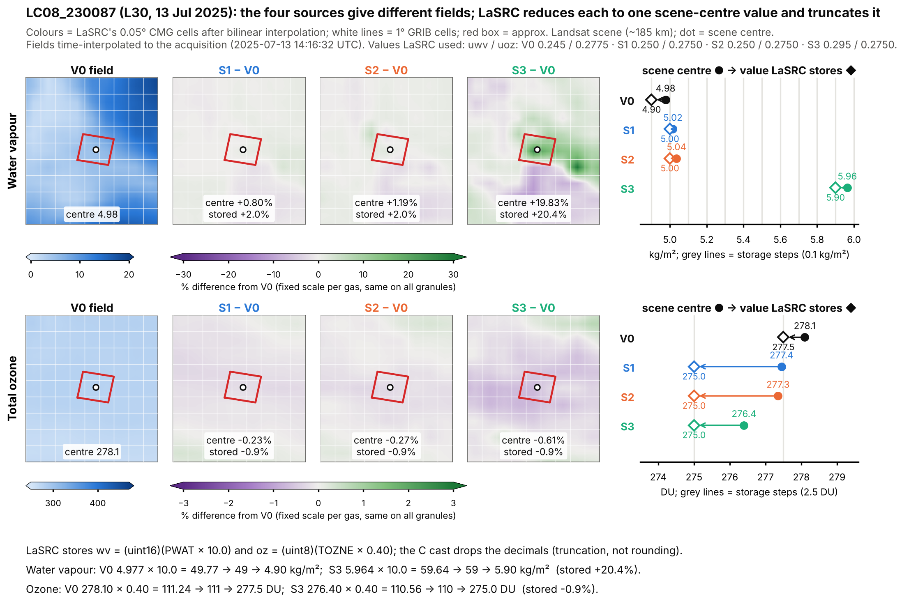
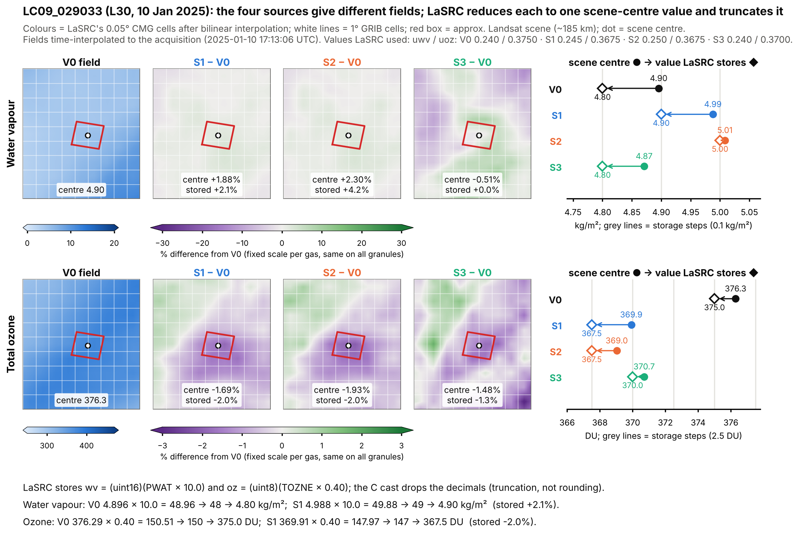
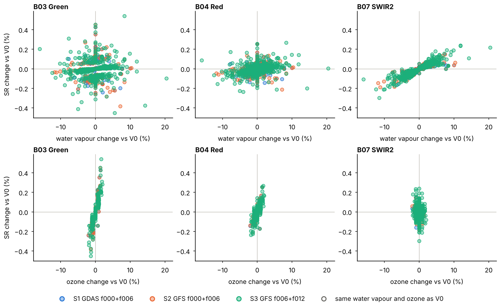
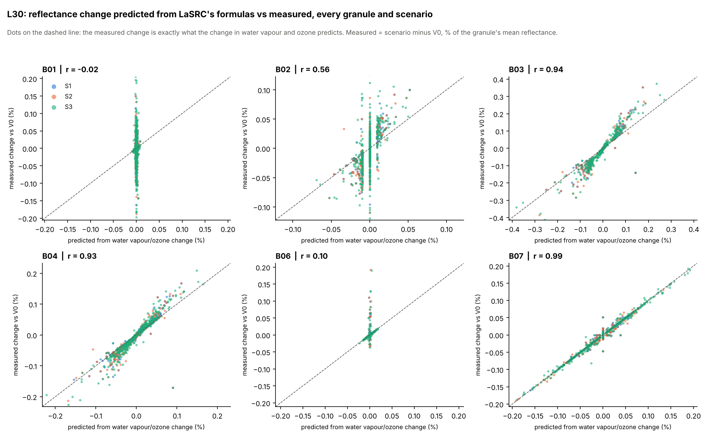

# How sensitive is LaSRC surface reflectance to water vapor and ozone?

Forecast ancillary files (S1–S3) give LaSRC water vapor values that differ from the GDAS analyses
(V0) by up to 20%, yet surface reflectance (SR) changes by less than 0.6%. This note explains why, in
four steps:

1. **What LaSRC actually reads** from the GRIB files: one value per scene, interpolated and then
   truncated to coarse steps (section 2).
2. **How LaSRC uses that value**: only for gas absorption, which is weak in the HLS bands (section 3).
3. **What the sources actually change**: the inputs (section 4) and the SR measured in the 614 L30
   granules (section 5).
4. **How far the inputs would have to be off to fail validation** (section 6).

Related: [FULL_L30_ANCILLARY_LATENCY_RESULTS.md](FULL_L30_ANCILLARY_LATENCY_RESULTS.md) (validation
results), [ANCILLARY_SOURCE_COMPARISON.md](ANCILLARY_SOURCE_COMPARISON.md) (the GRIB fields),
[ANCILLARY_INPUT_VERIFICATION.md](ANCILLARY_INPUT_VERIFICATION.md) (checking which files each run used).

Scenarios: **V0** GDAS analyses C1 + C2 (current) · **S1** GDAS C1 f000 + f006 · **S2** GFS C1 f000 + f006 ·
**S3** GFS 6- and 12-h forecasts from the previous cycle (C1 − 6 h). C1 / C2 are the 6-hourly cycles
before and after the overpass.

## 1. Summary

- **LaSRC reduces each GRIB field to one number per scene.** It interpolates the two files in time,
  interpolates the 1° grid bilinearly onto a 0.05° grid, reads the cell at the scene centre and
  stores it as an integer by **truncation**: water vapor in steps of 0.1 kg/m², ozone in steps of
  2.5 DU. Differences elsewhere in the scene play no part.
- **Truncation erases most small differences.** The ozone value LaSRC used was identical to V0 in
  508 / 482 / 396 of 614 granules (S1 / S2 / S3), and water vapor in 251 / 197 / 96. A difference
  that crosses a step boundary becomes one full step instead.
- **The sources differ little where it matters.** Median difference in the value LaSRC used: water
  vapor 0.4 / 0.7 / 1.8%, ozone 0 / 0 / 0%. The largest: water vapor 20.4% (a very dry scene, where
  one step is already 2%), ozone 2.0%.
- **The HLS bands sit in atmospheric windows.** A 20% water vapor change moves SWIR2 by about 0.4% and
  the other bands by ≤ 0.12%. A 20% ozone change moves green by 1.4% and red by 0.7–0.9%.
- **The real runs confirm this.** Across all 1,842 granule-scenario pairs the SR change vs V0 is
  below 0.6% in every band: green ≤ 0.54% and red ≤ 0.27% (driven by ozone), SWIR2 ≤ 0.3% (driven by
  water vapor). The change predicted from LaSRC's formulas matches the measured change
  (correlation 0.93–0.99 in green, red and SWIR2).
- **Large margin.** Thresholds are 4.6–5.3% of a typical reflectance. To fail, ozone would have to be
  off by about +67% (green) or +104% (red), and water vapor by about +360% (SWIR2), far beyond the
  20% / 2% seen between sources.

## 2. What LaSRC reads from the GRIB files

| Step | What happens | Code |
|---|---|---|
| 1 Read | PWAT (kg/m²) and TOZNE (DU) from the two GRIB files, 1° global grid, valid at C1 and C2 | `lut_subr.c` |
| 2 Time | weighted by acquisition time: w2 = (t − C1) / 6 h, w1 = 1 − w2 | `lut_subr.c` |
| 3 Space | bilinear interpolation of the 1° grid onto the 0.05° CMG grid (3600 × 7200 cells), then the cell at the scene centre | `get_cart_interp` (`lut_subr.c`), `compute_refl_subr.c` |
| 4 Store | `wv = (uint16)(PWAT × 10.0)`, `oz = (uint8)(TOZNE × 0.40)`: the C cast **truncates** | `lut_subr.c` |
| 5 Use | `uwv = wv / 200`, `uoz = oz / 400` (atm-cm) | `compute_refl_subr.c` |

`uwv` is PWAT / 20 (LaSRC calls it g/cm², but numerically it is half the true g/cm²; only relative
changes matter here). One storage step is 0.1 kg/m² of PWAT (0.005 in `uwv`) and 2.5 DU of ozone
(0.0025 in `uoz`).

### 2.1 Step 3: bilinear interpolation at the scene centre



*T15VVD (S30, 27 Jan 2025). White lines: the 1° GRIB cells around the four grid points v1–v4. Red:
the tile; dot: scene centre; orange: the 0.05° cell LaSRC reads. Its value is the weighted sum
`(1−r)(1−c)·v1 + r(1−c)·v2 + r·c·v3 + c(1−r)·v4`, with weights 0.19 / 0.56 / 0.19 / 0.06 here.*

- The scene centre is the centre of the tile (Sentinel-2) or WRS-2 scene (Landsat), computed by
  LaSRC from the image grid. For T15VVD it is 57.2469°N, 93.7480°W, exactly the tile centre.
- LaSRC fills **all 26 million** CMG cells for both gases but uses one. Computing only that cell with
  the same formula gives the identical value: a safe speed-up.
- Replacing bilinear interpolation with the nearest grid point is **not** equivalent. Over all land
  cells of six GDAS analyses the nearest value differs by a median of 2.9% (water vapor) and 0.3%
  (ozone), and the stored integer changes in 85% and 42% of cells
  ([figure](figures/gas_sensitivity/nearest_vs_bilinear.png)).

### 2.2 Step 4: truncation

Worked example, T15VVD, S1 run:

```text
water vapor: PWAT 1.468 kg/m²  × 10.0 = 14.68  → 14  → uwv = 14/200  = 0.070   (stored 1.40 kg/m²)
ozone:       TOZNE 398.81 DU   × 0.40 = 159.52 → 159 → uoz = 159/400 = 0.3975  (stored 397.5 DU)
```

Truncation always rounds down: 398.8 DU is stored as 397.5 DU, not 400. As a result:

- a difference smaller than one step usually disappears (both values land in the same step);
- a tiny difference that happens to straddle a step boundary becomes a full step (≈ 0.6% for water
  vapor at the median value, ≈ 0.9% for ozone).



*Each dot is one L30 granule and scenario. x: difference from V0 before storage; y: difference in the
value LaSRC used. Hollow grey: difference erased. Ozone splits into "erased" (y = 0) and "one step"
(y ≈ ±0.9%) clusters.*

| | Water vapor | Ozone |
|---|---|---|
| Storage step | 0.1 kg/m² (≈ 0.6% of the median 15.6 kg/m²) | 2.5 DU (≈ 0.9% of the median 282 DU) |
| Same stored value as V0 (S1 / S2 / S3) | 251 / 197 / 96 of 614 | 508 / 482 / 396 of 614 |
| Median difference before storage | 0.44 / 0.67 / 1.74% | 0.09 / 0.13 / 0.25% |
| Largest difference before storage | 7.3 / 11.8 / 19.8% | 1.7 / 1.9 / 2.0% |

The reproduction of steps 1–5 matches the values LaSRC logged in 88% (water vapor) and 99.6% (ozone)
of runs; the rest are one step off because of float rounding at a step boundary.

## 3. How LaSRC uses the two values

`uwv` and `uoz` enter the correction in one place, the gas transmittance (`comptg` in `lut_subr.c`):

```text
air-mass factor:            m    = 1/cos(sun zenith) + 1/cos(view zenith)
ozone transmittance:        T_oz = exp( a_oz[band] · m · uoz )
water vapor transmittance:  T_wv = exp( −a_wv[band] · (m · uwv) ^ b_wv[band] )
```

SR is the satellite reflectance divided by these transmittances (with the Rayleigh and aerosol
terms, which do not depend on `uwv` or `uoz`). To first order:

```text
relative change in SR  ≈  − [ change in ln T_oz  +  change in ln T_wv ]
```

The more a gas absorbs in a band, the more an error in it matters. The absorption is fixed by
coefficients from 6S radiative-transfer runs, hard-coded in LaSRC:

| L30 band | a_oz (ozone) | a_wv (water vapor) | b_wv | Gas that matters |
|---|---|---|---|---|
| B01 Ultrablue | −0.0026 | ~0 | 1.00 | (almost none) |
| B02 Blue | −0.018 | ~0 | 1.00 | ozone, a little |
| B03 Green | −0.097 | 0.0019 | 0.78 | **ozone** |
| B04 Red | −0.061 | 0.0040 | 0.77 | **ozone**, some water vapor |
| B05 NIR | ~0 | 0.0007 | 0.89 | (almost none) |
| B06 SWIR1 | ~0 | 0.0007 | 0.94 | (almost none) |
| B07 SWIR2 | ~0 | 0.0178 | 0.65 | **water vapor** |

Sentinel-2 (S30) is similar: ozone in B02–B04, water vapor mainly in B12 (SWIR2), a little in B04,
B8A and B11 (`compute_sentinel_refl.c`).

### 3.1 Expected sensitivity of each band

From the formulas above, reference `uwv` 1.0 (PWAT 20 kg/m²), ozone 300 DU, sun 45° from overhead
(shading: 30° to 70°). Grey band: the range of real differences between sources.




| | +20% water vapor | +20% ozone | one ozone step (2.5 DU) | one water vapor step (0.1 kg/m²) |
|---|---|---|---|---|
| L30 B01 Ultrablue | 0.00% | 0.04% | 0.002% | 0.000% |
| L30 B02 Blue | 0.00% | 0.26% | 0.011% | 0.000% |
| L30 B03 Green | 0.06% | 1.40% | 0.059% | 0.002% |
| L30 B04 Red | 0.12% | 0.89% | 0.037% | 0.003% |
| L30 B05 NIR | 0.03% | 0.00% | 0.000% | 0.001% |
| L30 B06 SWIR1 | 0.03% | 0.00% | 0.000% | 0.001% |
| L30 B07 SWIR2 | 0.40% | 0.00% | 0.000% | 0.010% |
| S30 B02 Blue | 0.00% | 0.39% | 0.016% | 0.000% |
| S30 B03 Green | 0.03% | 1.43% | 0.060% | 0.001% |
| S30 B04 Red | 0.10% | 0.72% | 0.030% | 0.003% |
| S30 B8A NIR narrow | 0.02% | 0.00% | 0.000% | 0.000% |
| S30 B11 SWIR1 | 0.03% | 0.00% | 0.000% | 0.001% |
| S30 B12 SWIR2 | 0.40% | 0.00% | 0.000% | 0.010% |

The curves' water vapor axis is in LaSRC's `uwv` units. Because `b_wv` < 1, the same percentage
change matters slightly more in dry air and at low sun (larger `m`).

## 4. What the sources change: three granules

Each figure shows, for one granule, the water vapor and ozone fields of V0 and the % difference of
S1–S3 (0.05° CMG cells after bilinear interpolation, white lines = 1° GRIB cells), and on the right
how each scenario's scene-centre value (dot) is truncated to the value LaSRC stores (diamond).

### 4.1 Typical case: different fields, identical values (T15VVD, S30, 27 Jan 2025)



Around the scene the fields differ by up to ±15% (water vapor) and ±2% (ozone). At the scene centre
the four sources differ by ≤ 1.6% and ≤ 0.2%, and all fall into the same storage step: LaSRC uses
`uwv` 0.070 and `uoz` 0.3975 in all four runs, so SR is identical.

### 4.2 Largest water vapor difference (LC08 230087, Patagonia, 13 Jul 2025)



A dry scene (≈ 5 kg/m²), so one step is already 2%. S3's 12-h forecast is 19.8% wetter at the scene
centre, a real forecast difference rather than a rounding effect, stored as 4.90 → 5.90 kg/m²
(+20.4%). Ozone differs by only 0.2–0.6% but crosses a step (277.5 → 275.0 DU, −0.9%).

| SR change vs V0 | B03 Green | B04 Red | B07 SWIR2 |
|---|---|---|---|
| S1 | −0.16% (−1 DN) | −0.07% (−1 DN) | +0.02% (0 DN) |
| S2 | −0.16% (−1 DN) | −0.07% (−1 DN) | +0.02% (0 DN) |
| S3 | −0.10% (−1 DN) | 0.00% (0 DN) | **+0.22% (+3 DN)** |
| Threshold | 54 DN | 66 DN | 87 DN |

The 20% water vapor change moves only SWIR2, by 3 DN.

### 4.3 Largest ozone difference (LC09 029033, Kansas, 10 Jan 2025)



The forecasts have 1.5–1.9% less ozone at the scene centre; truncation turns S1's −1.7% into −2.0%
(376.3 → 375.0 DU vs 369.9 → 367.5 DU).

| SR change vs V0 | B03 Green | B04 Red | B07 SWIR2 |
|---|---|---|---|
| S1 | **−0.24% (−23 DN)** | −0.14% (−14 DN) | +0.04% (0 DN) |
| S2 | −0.24% (−23 DN) | −0.14% (−13 DN) | +0.06% (0 DN) |
| S3 | −0.16% (−15 DN) | −0.10% (−10 DN) | +0.01% (0 DN) |
| Threshold | 54 DN | 66 DN | 87 DN |

The scene is snow-covered (green reflectance ≈ 0.95), so a small relative change is a larger DN
change. This is why the largest DN changes in the test are winter scenes, while in % they stay small.

The same three granules on the raw 1° GRIB cells (before the bilinear step):
[T15VVD](figures/gas_sensitivity/fields_to_scene_T15VVD_grib1deg.png),
[LC08 230087](figures/gas_sensitivity/fields_to_scene_LC08_230087_grib1deg.png),
[LC09 029033](figures/gas_sensitivity/fields_to_scene_LC09_029033_grib1deg.png).

## 5. Measured SR response in all L30 runs (614 granules × 3 scenarios)

SR change vs V0 is computed per granule and band from the immediate LaSRC outputs:

```text
SR change (%)  = 100 × (mean SR of the scenario − mean SR of V0) / mean SR of V0
               = 100 × mean_diff_refl / mean_pre_refl   (validation CLI)
```

over the pixels with data in both images (fill excluded; clouds and snow are not masked). The x-axis
is the % change in the value LaSRC used (after truncation).



- **Ozone drives green and red.** Ozone changes of ≤ 2% line up with green and red changes of up to
  0.54% and 0.27%; SWIR2 does not respond.
- **Water vapor drives SWIR2 only.** Water vapor changes of up to ±20% give SWIR2 changes of ≤ 0.3%
  and barely move green and red (the column of dots at 0% water vapor change is the ozone effect).
- **Every change is below 0.6%.** Median green change vs V0: 0.00 / 0.00 / 0.02% (S1 / S2 / S3).

### 5.1 Prediction vs measurement

For each pair, the change predicted from that granule's own water vapor and ozone change and sun
angle (section 3) against the measured change:



| Band | Correlation (1,842 pairs) | Within ±0.02% or ±50% of prediction |
|---|---|---|
| B03 Green | 0.94 | 88% |
| B04 Red | 0.93 | 94% |
| B07 SWIR2 | 0.99 | 99% |
| B02 Blue | 0.56 | 79% |
| B01 Ultrablue | (prediction ≈ 0) | 72% |
| B06 SWIR1 | (prediction ≈ 0) | 97% |

- In green, red and SWIR2 the measured change is the gas-absorption effect. Green and red sit slightly
  above the line: the first-order formula leaves out absorption on the atmospheric path, which adds a
  little for dark scenes.
- Ultrablue, blue and SWIR1 show small changes (mostly within ±0.1%) where almost none is predicted.
  These come indirectly through the aerosol retrieval, which uses the corrected bands.

## 6. How far off would the inputs have to be to fail validation?

Threshold of each band as a percentage of a typical reflectance (median over the 614 L30 granules),
and the input change needed for the predicted SR change to reach it (sun 45°):

| L30 band | Typical reflectance | Threshold | = % of reflectance | Water vapor change needed | Ozone change needed |
|---|---|---|---|---|---|
| B01 Ultrablue | 0.064 | 53 DN | 8.2% | > 1000% | > 1000% |
| B02 Blue | 0.076 | 56 DN | 7.4% | > 1000% | +573% |
| B03 Green | 0.116 | 54 DN | 4.7% | > 1000% | **+67%** |
| B04 Red | 0.144 | 66 DN | 4.6% | > 1000% | **+104%** |
| B06 SWIR1 | 0.228 | 131 DN | 5.8% | > 1000% | > 1000% |
| B07 SWIR2 | 0.163 | 87 DN | 5.3% | **+360%** | > 1000% |

The largest differences between sources in the full L30 run (20.4% water vapor, 2.0% ozone, after
truncation) are an order of magnitude or more below these. Consistently, no granule fails against
V0 in any band, and the failures against VIIRS (all B03, all January: V0 4, S1 1, S2 2, S3 1) are
not caused by the forecast inputs.

## 7. Direct confirmation with LaSRC (proposed, not yet run)

Sections 3–6 use LaSRC's formulas and the existing runs. A direct check is to rerun a few granules
with the GDAS fields deliberately shifted, so that only the input changes:

- **Granules:** 5 L30 and 3 S30 (dry / humid, dark / bright, low / high sun).
- **Shifts to V0's two GDAS files** (`grib2_offset_stdlib.py`): PWAT −5, +5, +10, +20 kg/m²;
  TOZNE −50, −25, +25, +50 DU.
- **Runs:** 8 per granule, about 64 in total (L30 ≈ 6 min, S30 ≈ 36 min each).
- **Result:** measured SR change vs input change per band, on top of the curves in section 3.1.

Set-up is in [ANCILLARY_INPUT_VERIFICATION.md, section 7](ANCILLARY_INPUT_VERIFICATION.md#7-change-the-input-files).
The smoke test already ran one such case (+10 kg/m² of water vapor at T15VVD and T43VDD), which
changed the value LaSRC used as expected.

## 8. Reproducing

Scripts are in [tools/](tools/) (copies of those on meteor under `$R/scripts`).

```bash
R=/rtmp/tvo/LaSRC_ancillary_latency_20261120
# section 3.1 curves, section 5.1 predicted vs observed
python $R/scripts/gas_sensitivity.py --product L30 \
  --table $R/reports_full/scene_centre_values_l30.csv \
  --change $R/reports_full/maps/change_vs_v0_percent.csv \
  --v0-metrics $(ls $R/validation_full/L30_V0_vs_VIIRS_immediate/reports/lasrc_validation_metrics_*.csv | tail -1) \
  --out $R/reports_full/gas_sensitivity
python $R/scripts/gas_sensitivity.py --product S30 --out $R/reports_full/gas_sensitivity

# section 2.2 storage effect and section 5 scatter (slide_storage_effect, slide_sr_vs_inputs)
python tools/slide_figures.py --table $R/reports_full/scene_centre_values_l30.csv \
  --vs-viirs <4 metrics CSVs> --vs-v0 <3 metrics CSVs> --out figures/gas_sensitivity

# section 2.1 interpolation (no global comparison) and the nearest-vs-bilinear comparison
python tools/plot_spatial_interp.py --no-hist --tile 15VVD --record <S1 run record of T15VVD> \
  --pair <V0 C1 file> <V0 C2 file> --anl <V0 C1 file> --name T15VVD --out figures/gas_sensitivity
python tools/plot_spatial_interp.py --tile 15VVD --record <...> --pair <...> \
  --anl <six GDAS analyses> --name T15VVD --out figures/gas_sensitivity

# section 4 granule figures (add --grib for the 1-degree versions; --landsat draws an approximate WRS-2 box)
python tools/plot_fields_to_scene.py --tile 15VVD --label "S30, 27 Jan 2025" --record <S1 record> \
  --v0 <C1 f000> <C2 f000> --s1 <C1 f000> <C1 f006> --s2 <GFS C1 f000> <GFS C1 f006> \
  --s3 <GFS C1-6h f006> <GFS C1-6h f012> --name T15VVD --out figures/gas_sensitivity
```

`scene_centre_values.py` (in tools/) holds the GRIB2 reader and the reproduction of LaSRC's steps 1–5
used by all of these. The S30 run-based check (section 5) will be added when the S30 validation is
complete.
