# Pilot results: low-latency ancillary sources in LaSRC (S30 and L30)

Preliminary results from the pilot of the large-scale test planned in
[LARGE_SCALE_ANCILLARY_TEST_PLAN.md](LARGE_SCALE_ANCILLARY_TEST_PLAN.md). Background on how LaSRC
reads the GRIB water vapor and ozone, and the 3-granule smoke test, are in
[ANCILLARY_SOURCE_COMPARISON.md](ANCILLARY_SOURCE_COMPARISON.md).

**Status:** preliminary (pilot, 10 S30 + 10 L30 granules, 19 Nov 2026). The full run (605 S30 +
614 L30 granules) has not started yet. One open item, the S30 granule T16TCK, is described in
[section 4](#4-the-t16tck-outlier).

## 1. What was run

| Run | File valid at C1 | File valid at C2 | Ancillary ready after acquisition |
|---|---|---|---|
| **V0** baseline (existing validated outputs) | GDAS C1 f000 | GDAS C2 f000 | 7–13 h |
| **S1** | GDAS C1 f000 | GDAS C1 f006 | 1–7 h |
| **S2** | GFS C1 f000 | GFS C1 f006 | 0–3.6 h |
| **S3** | GFS CP f006 | GFS CP f012 | 0 (before the overpass) |

C1 is the 6-hourly cycle at or before the acquisition, C2 = C1 + 6 h, CP = C1 − 6 h. All files
are NOAA NODD 1° `pgrb2.1p00`, relabelled so LaSRC reads them as the two bracketing analyses.

- **Granules:** 10 S30 and 10 L30 from the validation set, half January and half July 2025,
  spread through each list (`lists/<p>/pilot.txt`).
- **Processing:** the validated HLS containers on Meteor (S30
  `hls-sentinel-apptainer-prep-20260702.sif`, L30 `hls-landsat-c2-b271310-20260722.sif`), with the
  two GRIB files per scenario chosen by `select_pair.py` and logged per granule
  (`records/<p>/<S>/<granule>.json`: files, md5, time weights, scene-centre `uwv`/`uoz`).
  All 60 scenario runs (2 products × 3 scenarios × 10 granules) finished with exit status 0.
- **Validation:** the existing LaSRC validation CLI (`lasrc_container_validation_cli.py`, same
  configs and Ju et al. (2025) Table 7 thresholds as the GDAS-vs-VIIRS validation). Every run,
  including V0, is compared with the **VIIRS-ancillary run** of the same granules. A granule
  passes a band when |mean difference| is at or below the band threshold.
- **Stages:** S30 immediate (ESPA SR) and final (HLS COG); L30 immediate only. The CLI reads final
  products as HLS `B##.tif` COGs, and the L30 container writes HDF, so L30 final is not compared
  (the earlier L30 GDAS-vs-VIIRS validation was immediate-only for the same reason).
- **Pairs:** S30 has 9 validated granules per scenario (T35TNG has no VIIRS pair); L30 has 10.

## 2. Summary

Granules failing at least one band (bands as in the CLI summary figure: S30 B01–B04, B11, B12;
L30 B01–B04, B06, B07):

| Product, stage | V0 vs VIIRS | S1 vs VIIRS | S2 vs VIIRS | S3 vs VIIRS |
|---|---|---|---|---|
| S30 final | 0 / 9 | 1 / 9 | 1 / 9 | 1 / 9 |
| S30 immediate | 0 / 9 | 1 / 9 | 1 / 9 | 1 / 9 |
| L30 immediate | 0 / 10 | 0 / 10 | 0 / 10 | 0 / 10 |

- **L30:** every scenario passes on every granule and band. The largest difference is 23.7 DN
  (S3, B03, threshold 54 DN); medians are below 3 DN in every band.
- **S30:** 8 of 9 granules pass in every scenario, with medians below 1.5 DN. The single failure
  is the same granule in S1, S2 and S3: **T16TCK, 9 Jan 2025** (central Illinois), above the
  threshold in B01–B04 by 4–42 %. It passes in V0 vs VIIRS, where its largest difference is 15 DN. See [section 4](#4-the-t16tck-outlier).
- **The three scenarios give almost the same reflectance.** For each granule and band, the spread
  between S1, S2 and S3 has a median of 0.1 DN and a maximum of 8.1 DN (L30 LC09 011026, B03,
  S3 against S1/S2); the spread between granules is far larger than the spread between scenarios.

## 3. Scene-centre water vapor and ozone used by LaSRC

LaSRC uses one water vapor (`uwv`, g/cm²) and ozone (`uoz`) value at the scene centre, stored on
its grid in steps of 0.005 g/cm² and 2.5 DU.

### 3.1 How the values are obtained

- **S1, S2, S3: read from the LaSRC log.** LaSRC prints `uwv, uoz, pres: …` for every run;
  `run_record.py` copies these, the scene-centre latitude/longitude and the two time weights into
  `records/<p>/<S>/<granule>.json`. These are the values LaSRC actually used.
- **V0: reproduced from the GRIB files, no container run.** The V0 outputs come from the earlier
  validated run, which did not write these records, so `scene_centre_values.py` recomputes the
  values from V0's two GDAS analyses (GDAS C1 f000 and C2 f000 from the mirror, chosen by the same
  `select_pair.py` as the runs). It repeats LaSRC b271310's steps:
  1. read PWAT (kg/m²) and TOZNE (DU) from each file on the 1° grid (GRIB2 decoded with numpy;
     the decoder matches eccodes to 1e-13);
  2. time-interpolate with LaSRC's own weights, `w1·file1 + w2·file2`, where `w2` = (acquisition −
     C1) / 6 h; V0 and S1 share C1, C2 and the acquisition time, so the weights and scene centre
     are taken from the S1 record of the same granule;
  3. bilinear-resample to the 0.05° CMG cell nearest the scene centre, reading the grid the same
     way LaSRC does;
  4. truncate to LaSRC's integer storage, `wv = int(PWAT·10)`, `oz = int(TOZNE·0.4)`, and convert,
     `uwv = wv / 200`, `uoz = oz / 400`.
- **Check of the method.** Run on S2 and S3, where LaSRC's logged values are known, it reproduces
  33 of 40 runs exactly. In the other 7 one of the two values is off by exactly one storage step
  (0.005 g/cm² or 2.5 DU); in each of those the interpolated value is within 0.15 of a storage
  boundary, so the difference is floating-point detail in LaSRC's resampling, not a different
  method. V0 values are therefore exact or within one storage step. They are written to
  `records/<p>/V0/` with `source: reproduced…`, and the V0 map panels are labelled
  "reproduced from GRIB".

### 3.2 Values

Across the pilot:

| Product | Pair | Granules with different `uwv` | Max \|Δuwv\| (g/cm²) | Granules with different `uoz` | Max \|Δuoz\| (DU) |
|---|---|---|---|---|---|
| S30 | S1 vs S2 | 6 / 10 | 0.010 | 2 / 10 | 2.5 |
| S30 | S1 vs S3 | 9 / 10 | 0.075 | 1 / 10 | 2.5 |
| L30 | S1 vs S2 | 5 / 10 | 0.040 | 1 / 10 | 2.5 |
| L30 | S1 vs S3 | 6 / 10 | 0.050 | 3 / 10 | 5.0 |

For scale, the pilot granules span 0.08–2.62 g/cm² of water vapor and 255–405 DU of ozone. The
scenarios do change the inputs (most granules get a different `uwv`), but by about one to two
quantisation steps, which is consistent with the near-identical reflectance.

| S30 water vapor | S30 ozone |
|---|---|
|  | 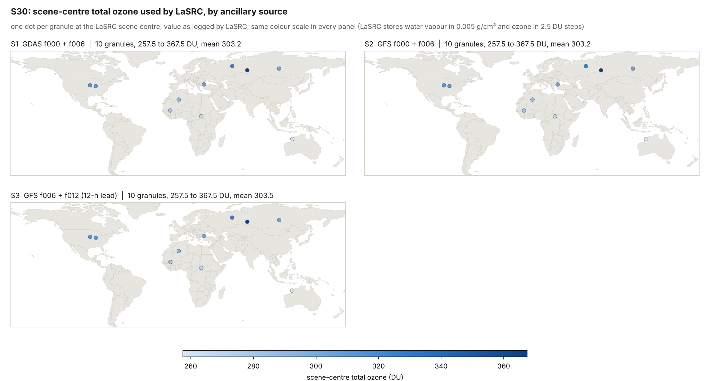 |

| L30 water vapor | L30 ozone |
|---|---|
| 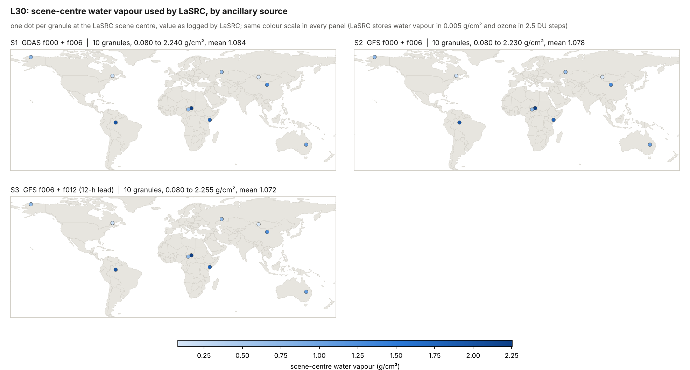 |  |

## 4. The T16TCK outlier

`S2A_MSIL1C_20250109T164651_N0511_R126_T16TCK_20250109T184430` (scene centre 40.14 N, 88.70 W,
mid-winter, `uwv` = 0.28 g/cm², `uoz` = 312.5 DU in S1 and S2, `uwv` = 0.285 in S3).

Final stage, per-granule |mean difference| vs VIIRS in HLS DN:

| | B01 | B02 | B03 | B04 |
|---|---|---|---|---|
| Threshold, final (DN) | 51 | 48 | 55 | 52 |
| V0 vs VIIRS | 1.2 | 5.0 | 15.3 | 8.9 |
| S1 vs VIIRS | 61.3 | 57.5 | 66.9 | 74.0 |
| S2 vs VIIRS | 61.3 | 57.5 | 66.9 | 74.0 |
| S3 vs VIIRS | 61.4 | 57.4 | 66.9 | 74.2 |

- S1 and S2 used **different GRIB files with the same scene-centre `uwv` and `uoz`** and produced
  the same reflectance; S3 differs by 0.005 g/cm² and by 0.2 DN at most.
- The S1-vs-V0 validation shows the same granule 65 DN away from V0 (B04), while the other nine
  granules are within 2 DN of V0, two of them identical.
- So the new runs agree with each other but not with V0 on this one granule. Either V0 used a
  noticeably different `uwv`/`uoz` here (V0 uses the C2 analysis at 18z instead of a forecast for
  18z), or the earlier V0 run differed in something other than the ancillary data.
- **Next check:** rerun V0 on the pilot granules through the same runner (`submit.sh pilot both
  V0`), which logs V0's own `uwv`/`uoz` and gives a like-for-like V0 output to compare.

## 5. Figures

### 5.1 Validation CLI summary (threshold boxplots)

The CLI's own `distribution_summary` figure, one per run: per-granule |mean difference| vs VIIRS,
red dashed lines at the thresholds.

| | V0 vs VIIRS | S1 vs VIIRS | S2 vs VIIRS | S3 vs VIIRS |
|---|---|---|---|---|
| S30 final | 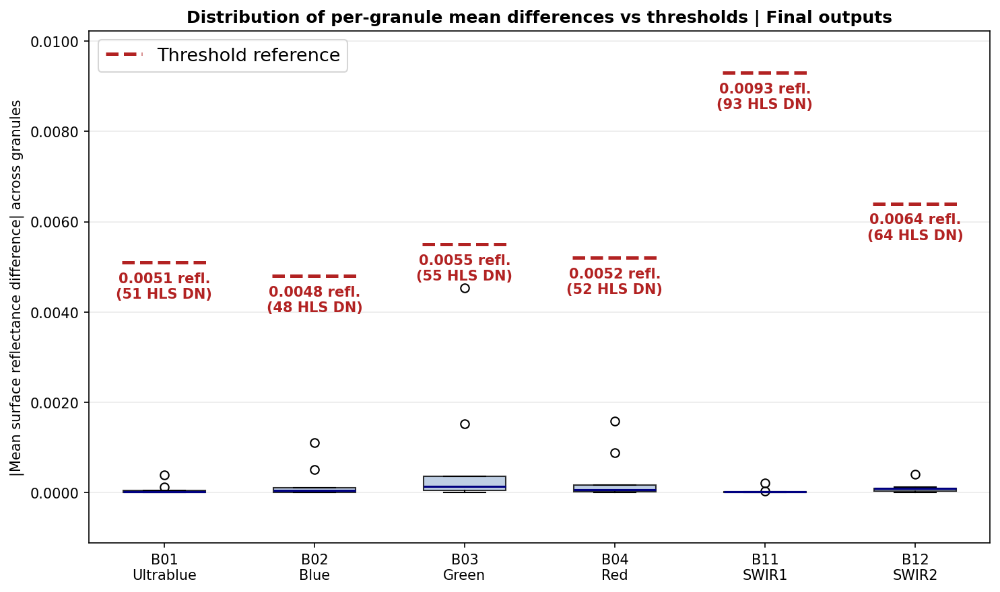 | 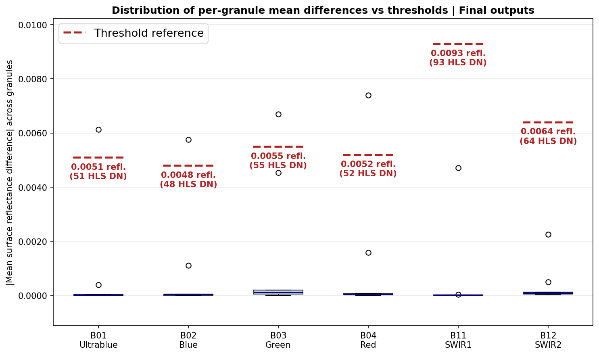 | 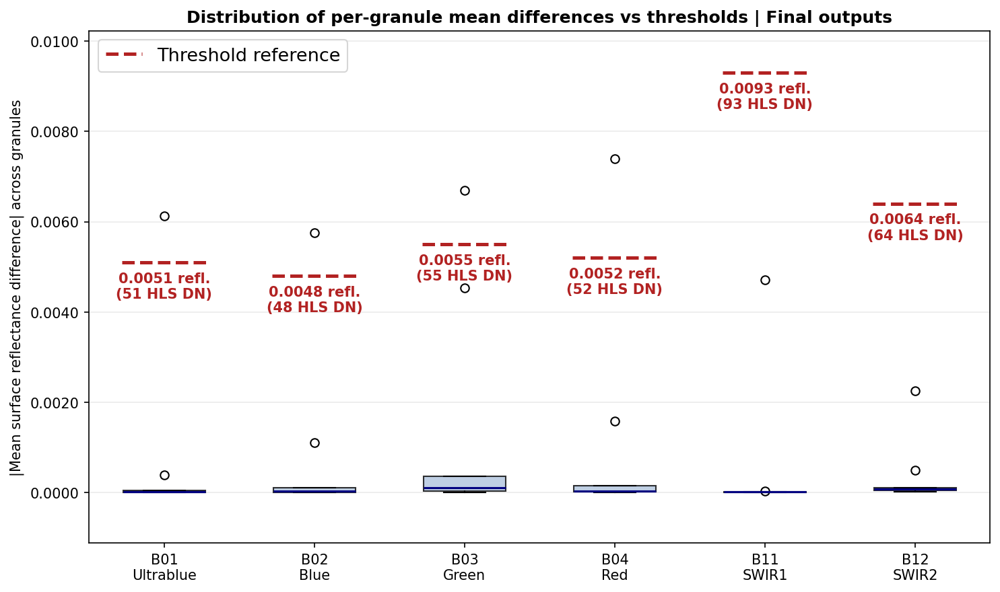 | 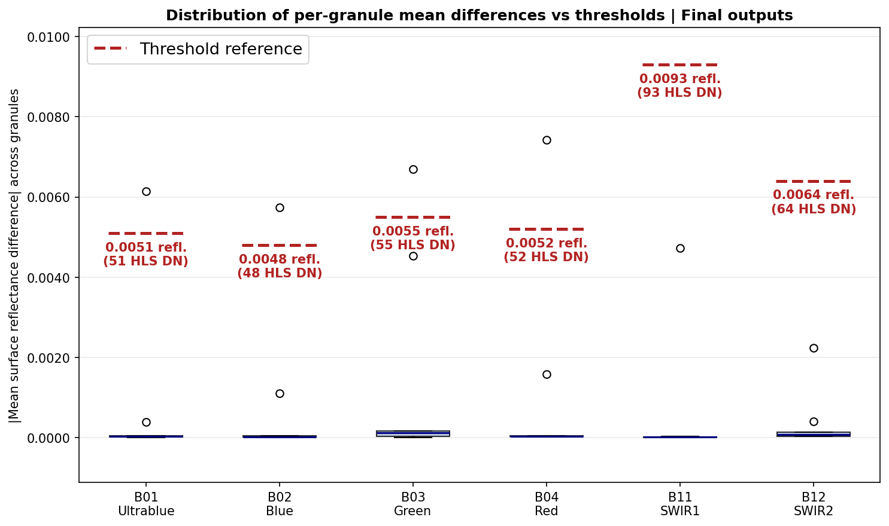 |
| S30 immediate | 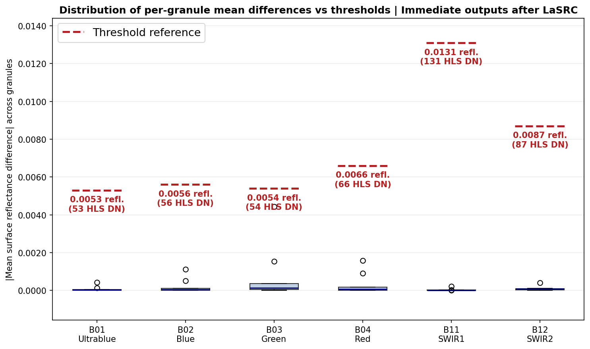 | 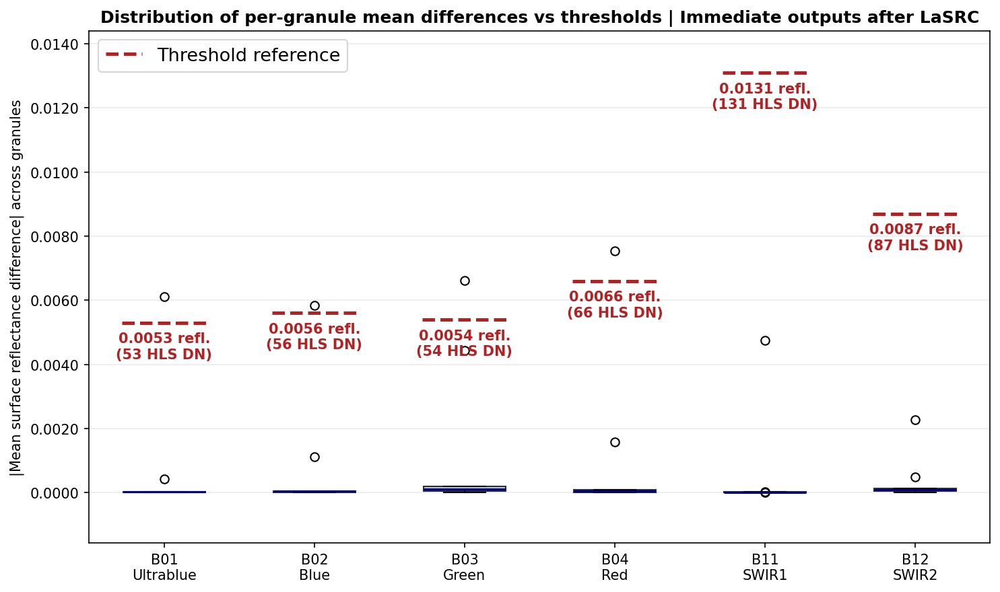 | 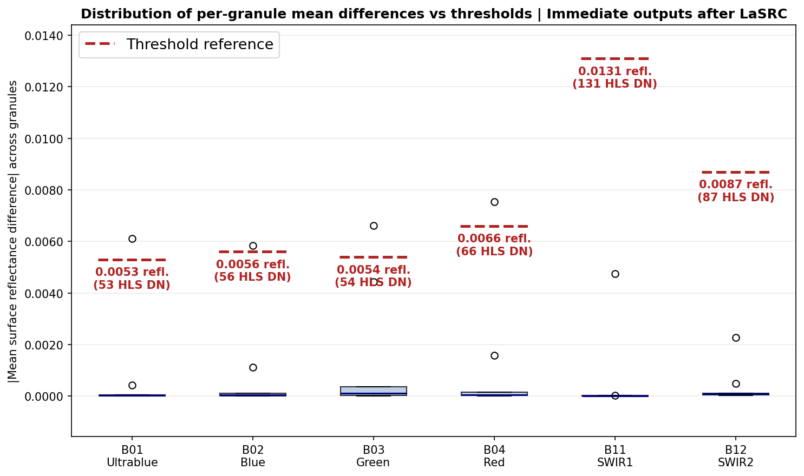 |  |
| L30 immediate |  | 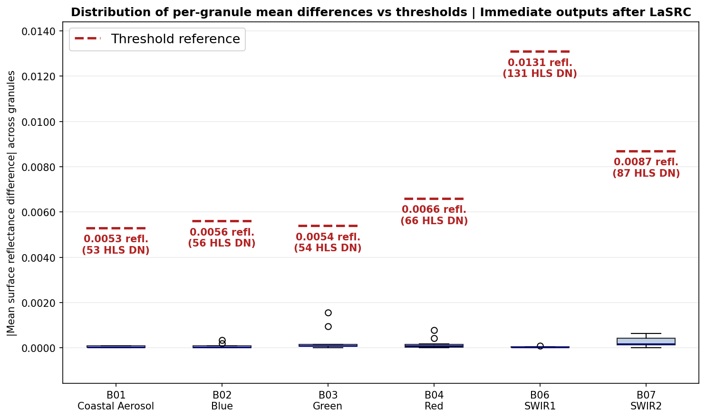 | 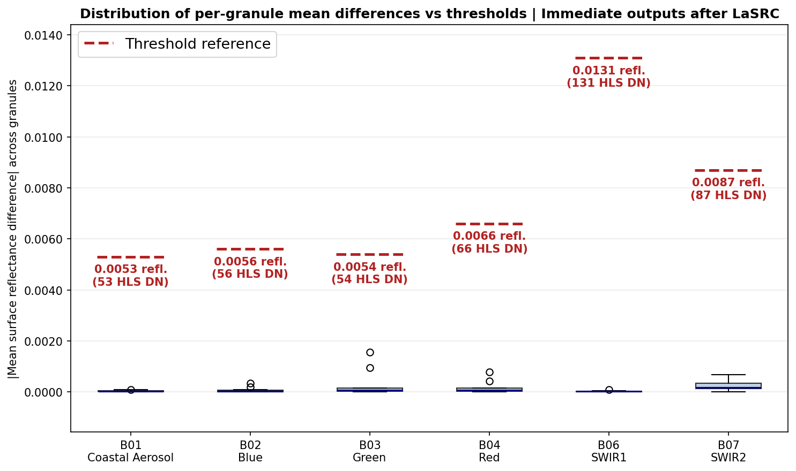 |  |

### 5.2 Spatial maps of the difference from VIIRS, per band

One figure per band and stage, one panel per scenario. Each dot is a granule at its LaSRC scene
centre; colour and size give |mean difference| vs VIIRS in HLS DN; a red outline marks a granule
above the band threshold, which is also the red line on the colour bar; the pie gives the share
of granules passing and failing.

S30 final, B04 (red):

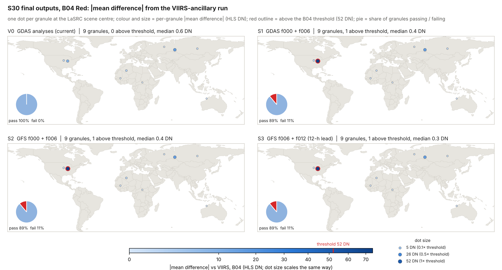

L30 immediate, B03 (green):


All bands:

- **S30 final:** [B01](figures/pilot_ancillary_latency/maps/S30_final/difference_vs_viirs_S30_final_B01.png) · [B02](figures/pilot_ancillary_latency/maps/S30_final/difference_vs_viirs_S30_final_B02.png) · [B03](figures/pilot_ancillary_latency/maps/S30_final/difference_vs_viirs_S30_final_B03.png) · [B04](figures/pilot_ancillary_latency/maps/S30_final/difference_vs_viirs_S30_final_B04.png) · [B11](figures/pilot_ancillary_latency/maps/S30_final/difference_vs_viirs_S30_final_B11.png) · [B12](figures/pilot_ancillary_latency/maps/S30_final/difference_vs_viirs_S30_final_B12.png)
- **S30 immediate:** [B01](figures/pilot_ancillary_latency/maps/S30_immediate/difference_vs_viirs_S30_immediate_B01.png) · [B02](figures/pilot_ancillary_latency/maps/S30_immediate/difference_vs_viirs_S30_immediate_B02.png) · [B03](figures/pilot_ancillary_latency/maps/S30_immediate/difference_vs_viirs_S30_immediate_B03.png) · [B04](figures/pilot_ancillary_latency/maps/S30_immediate/difference_vs_viirs_S30_immediate_B04.png) · [B11](figures/pilot_ancillary_latency/maps/S30_immediate/difference_vs_viirs_S30_immediate_B11.png) · [B12](figures/pilot_ancillary_latency/maps/S30_immediate/difference_vs_viirs_S30_immediate_B12.png)
- **L30 immediate:** [B01](figures/pilot_ancillary_latency/maps/L30_immediate/difference_vs_viirs_L30_immediate_B01.png) · [B02](figures/pilot_ancillary_latency/maps/L30_immediate/difference_vs_viirs_L30_immediate_B02.png) · [B03](figures/pilot_ancillary_latency/maps/L30_immediate/difference_vs_viirs_L30_immediate_B03.png) · [B04](figures/pilot_ancillary_latency/maps/L30_immediate/difference_vs_viirs_L30_immediate_B04.png) · [B06](figures/pilot_ancillary_latency/maps/L30_immediate/difference_vs_viirs_L30_immediate_B06.png) · [B07](figures/pilot_ancillary_latency/maps/L30_immediate/difference_vs_viirs_L30_immediate_B07.png)

### 5.3 Per-band numbers

Per-granule |mean difference| vs VIIRS in HLS DN (median / max over the granules), and the share
of granules within the threshold. Per-granule values are in
[`granule_band_difference_vs_viirs.csv`](figures/pilot_ancillary_latency/maps/granule_band_difference_vs_viirs.csv).

**L30 immediate** (n = 10 granules)

| Band | Threshold (DN) | V0 median / max (DN) | S1 median / max (DN) | S2 median / max (DN) | S3 median / max (DN) | Pass rate V0 / S1 / S2 / S3 |
|---|---|---|---|---|---|---|
| B01 | 53 | 0.4 / 1.2 | 0.3 / 1.0 | 0.3 / 1.0 | 0.5 / 0.8 | 100% / 100% / 100% / 100% |
| B02 | 56 | 0.3 / 3.9 | 0.3 / 3.4 | 0.3 / 3.4 | 0.3 / 5.1 | 100% / 100% / 100% / 100% |
| B03 | 54 | 0.9 / 19.7 | 0.9 / 15.6 | 0.8 / 15.6 | 0.6 / 23.7 | 100% / 100% / 100% / 100% |
| B04 | 66 | 0.9 / 10.5 | 0.8 / 7.8 | 0.6 / 7.8 | 0.8 / 12.3 | 100% / 100% / 100% / 100% |
| B06 | 131 | 0.2 / 0.9 | 0.3 / 0.8 | 0.3 / 0.9 | 0.3 / 0.7 | 100% / 100% / 100% / 100% |
| B07 | 87 | 1.6 / 6.8 | 1.7 / 6.4 | 1.7 / 6.8 | 2.5 / 7.6 | 100% / 100% / 100% / 100% |

**S30 final** (n = 9 granules)

| Band | Threshold (DN) | V0 median / max (DN) | S1 median / max (DN) | S2 median / max (DN) | S3 median / max (DN) | Pass rate V0 / S1 / S2 / S3 |
|---|---|---|---|---|---|---|
| B01 | 51 | 0.2 / 4.0 | 0.2 / 61.3 | 0.2 / 61.3 | 0.4 / 61.4 | 100% / 89% / 89% / 89% |
| B02 | 48 | 0.5 / 11.1 | 0.5 / 57.5 | 0.4 / 57.5 | 0.2 / 57.4 | 100% / 89% / 89% / 89% |
| B03 | 55 | 1.4 / 45.3 | 1.1 / 66.9 | 1.1 / 66.9 | 1.2 / 66.9 | 100% / 89% / 89% / 89% |
| B04 | 52 | 0.6 / 15.9 | 0.4 / 74.0 | 0.4 / 74.0 | 0.3 / 74.2 | 100% / 89% / 89% / 89% |
| B11 | 93 | 0.1 / 2.2 | 0.1 / 47.2 | 0.1 / 47.2 | 0.1 / 47.2 | 100% / 100% / 100% / 100% |
| B12 | 64 | 0.9 / 4.1 | 1.0 / 22.6 | 0.8 / 22.6 | 0.7 / 22.4 | 100% / 100% / 100% / 100% |

**S30 immediate** (n = 9 granules)

| Band | Threshold (DN) | V0 median / max (DN) | S1 median / max (DN) | S2 median / max (DN) | S3 median / max (DN) | Pass rate V0 / S1 / S2 / S3 |
|---|---|---|---|---|---|---|
| B01 | 53 | 0.2 / 4.3 | 0.2 / 61.1 | 0.2 / 61.1 | 0.3 / 61.2 | 100% / 89% / 89% / 89% |
| B02 | 56 | 0.5 / 11.2 | 0.5 / 58.4 | 0.4 / 58.4 | 0.2 / 58.3 | 100% / 89% / 89% / 89% |
| B03 | 54 | 1.4 / 44.3 | 1.1 / 66.2 | 1.1 / 66.2 | 1.2 / 66.2 | 100% / 89% / 89% / 89% |
| B04 | 66 | 0.6 / 15.9 | 0.4 / 75.4 | 0.4 / 75.4 | 0.3 / 75.7 | 100% / 89% / 89% / 89% |
| B11 | 131 | 0.1 / 2.2 | 0.2 / 47.5 | 0.1 / 47.5 | 0.1 / 47.6 | 100% / 100% / 100% / 100% |
| B12 | 87 | 1.0 / 4.1 | 1.0 / 22.7 | 0.8 / 22.7 | 0.7 / 22.5 | 100% / 100% / 100% / 100% |

## 6. Caveats

- **Small sample.** 9–10 granules per product; pass rates move by 10 % per granule.
- **V0 reuses the existing outputs.** The GDAS-analysis (V0) outputs already exist from the
  previous GDAS-vs-VIIRS validation, so V0 was not rerun; its scene-centre water vapor and ozone
  are recomputed from the GRIB files (section 3.1).
- **L30 final stage not compared** (no HLS COGs from the L30 container; see section 1).
- **Scene-centre values only.** LaSRC applies one `uwv`/`uoz` per scene, so the maps and
  table in section 3 show exactly what LaSRC used; within-scene gradients play no part.

## 7. Next steps

1. Rerun V0 on the pilot granules with the new runner and recheck T16TCK (section 4).
2. Launch the full run for S1–S3 (`submit.sh full both`, outputs trimmed to final + immediate).
3. Run the full validation and regenerate the figures above with the same scripts.

## 8. Reproducing

On Meteor, root `/rtmp/tvo/LaSRC_ancillary_latency_20261120`:

```bash
R=/rtmp/tvo/LaSRC_ancillary_latency_20261120
TRIM=yes bash $R/scripts/submit.sh pilot both            # S1-S3 runs, pilot lists
PRODUCTS="S30 L30" REFS="VIIRS" SUBMIT=1 bash $R/scripts/validate.sh   # scenario vs VIIRS
bash $R/scripts/validate_v0_vs_viirs.sh                  # V0 vs VIIRS on the same granules
python $R/scripts/scene_centre_values.py --root $R --check            # method vs LaSRC logs (S1-S3)
python $R/scripts/scene_centre_values.py --root $R --scenario V0 --write  # V0 uwv/uoz records
python $R/scripts/plot_pilot_difference_map.py --root $R # maps -> $R/reports_pilot/maps
```

The CLI boxplots are written by each validation job to
`$R/validation/<P>_<S>_vs_VIIRS_<stage>/plots/summary/`.
